# Home page

The section As deployed describes the home page as it is deployed today. The
sections after it are the target, the home page as it is meant to be, and the
section Changes lists every difference between the two as a numbered change.
Only a change the owner has approved is built, one change at a time; anything
no change names stays as it is deployed.

This page specifies the portal's home page and the bars above it: the top bar,
and the spaces bar under it. Where each kind of setting lives, and an addon's
setup checklist, are on [settings and setup](./settings.md).

## Purpose

The home page is the first page after signing in to zaentrum. It takes people
to the app they want, quickly: every app a person may open is a tile, and the
tiles are in spaces, one for each kind of work, with a bar under the top bar to
move between them. The home page follows the design system's
[home & tiles](https://nalet.github.io/design-system/patterns/home-and-tiles/)
pattern and its [top bar](https://nalet.github.io/design-system/patterns/top-bar/);
this page says what zaentrum puts on them.

## As deployed

This section says what the home page does as of 7 November 2026: the web as the
public demo showed it that day, signed in as the demo's viewer, an account that
isn't an admin, and what an admin sees, from the portal's code that day.
Figures 1 to 3 are screenshots of the viewer's home page. Figures 4 to 6 show
its states; for them, the browser that took the screenshots held back or
replaced the server's answer, so the page drew what the deployed code draws
for that answer. Nothing on the server changed.

### On a computer

Figure 1 shows the viewer's home page on a computer.

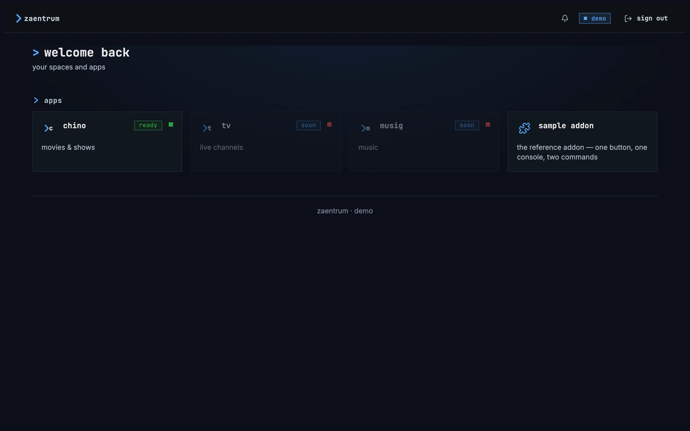

Figure 1: The home page as deployed on 7 November 2026, signed in as the
demo's viewer, on a computer, at 1280 × 800.

1. **Top left: the lockup**, zaentrum after a blue chevron, with a cursor after
   it that blinks, so not every screenshot has it. It leads home.
2. **Top right: the bell, the account's name and sign out.** The bell has no
   number while nothing is unread. The name, “demo”, is in a blue badge with a
   dot. **sign out**, a quiet button with an arrow leaving a door, signs out at
   once. There is no search and no avatar.
3. **The heading**: “welcome back” after a chevron, with “your spaces and apps”
   under it, on a faint blue glow.
4. **The group apps**, its name after a chevron, with four tiles. chino, “movies
   & shows”, has the badge “ready” and a green square, and opens chino in a new
   tab. tv, “live channels”, and musig, “music”, are faded, each with “soon”
   and a red square, and can't be opened. sample addon, “the reference addon —
   one button, one console, two commands”, is the demo's reference addon, with
   a puzzle piece, and opens inside the portal.
5. **The foot**: a rule and “zaentrum · demo”, the same on every installation.

The page is a column at most 1200 px wide, in the middle of the window, so on
this screen the heading and the tiles start 60 px from its left edge. The
tiles take as many columns as fit at 224 px, here four. The heading is a
second-level heading, as the groups' names are, so the page has no main
heading. The portal draws each group as a tile group on its own, not inside
the design system's home page component, so each group is one stop for the Tab
key, and the arrow keys move between the tiles of that group but not on into
the next.

### On a phone

Figure 2 shows the same page on a phone held upright.

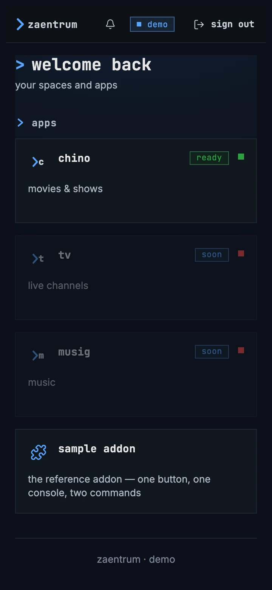

Figure 2: The home page as deployed on 7 November 2026, on a phone held
upright, at 360 × 780.

1. **The top bar**: the lockup, the bell, the badge with the name and **sign
   out**, in one row, as on a computer.
2. **The heading**, as on a computer, with the group's name under it.
3. **The tiles**, one under the other across the width, each as tall as on a
   computer: 112 px.
4. **The foot**, “zaentrum · demo”.

Figure 3 shows it on a phone held sideways.

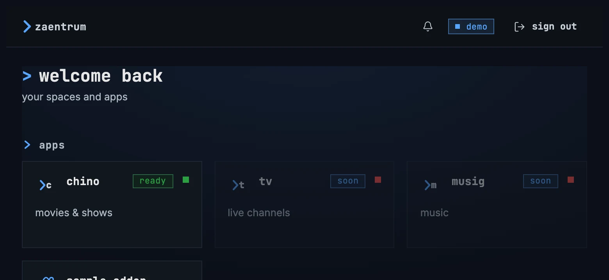

Figure 3: The home page as deployed on 7 November 2026, on a phone held
sideways, at 780 × 360.

1. **The heading and the group's name** take the upper half of the screen.
2. **The tiles, three across.** The fourth, sample addon, starts a row of its
   own at the screen's foot.

Under 720 px wide, the page has less room around it; otherwise a phone has
the computer's page.

### What an admin sees

An admin's home page has the viewer's, and more, as the portal's code has it.
Until an admin marks the platform as set up, a first-run checklist stands above
the groups, for admins only. The groups follow, one under the other: the
registry's spaces in their order, then settings, which the portal draws itself
after them.

| Group | Who sees it | Its tiles, in the code's words |
|---|---|---|
| apps | everyone signed in | chino, tv and musig, as in figure 1, and the tiles of every addon installed into apps, such as the demo's sample addon |
| manage | admins | “Catalog”, “browse the catalog”, and “Catalog Management”, “scan & settings”, each with the badge “admin” and a green square; then the tiles of the addons installed into manage |
| an addon's own | everyone signed in, until an admin narrows it in the registry | an addon's manifest may bring a space of its own, which the portal creates, with tiles that name no audience, one for each of the addon's views |
| settings | admins | registry “register apps, spaces & tiles”, People “accounts · invites · rating caps”, operator “instances · scale · update” with a green square, logs “container logs · redacted”, events “kafka topology · live tail”, database “curated tables · read-only” and export “support bundle · redacted”, each with the badge “admin”; they open the consoles inside the portal |

A tile shows its name in lowercase whatever case the registry stores, so
“Catalog Management” reads “catalog management”. Someone who holds the admin
role but signed in through another client gets no settings group, and a
sentence under the groups says that the portal's consoles stay closed for that
client.

### States

Figure 4 shows the page while it loads.

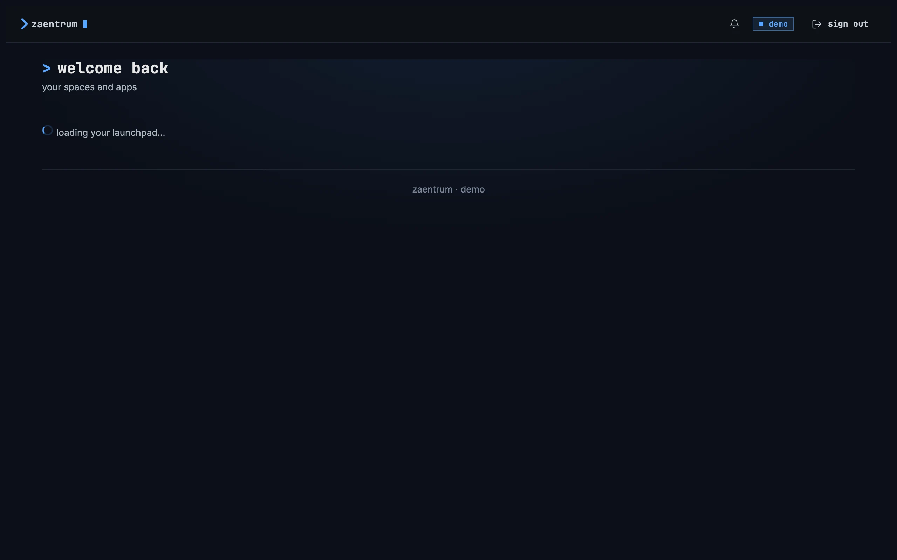

Figure 4: The home page loading, as deployed on 7 November 2026, on a
computer, at 1280 × 800.

1. **The heading**, there from the start.
2. **The loader**, a turning circle, and “loading your launchpad…” beside it,
   where the groups will be, from the first moment.

Figure 5 shows a phone when the server can't be reached.

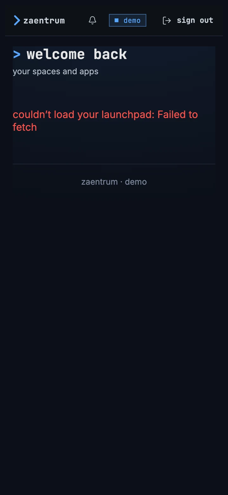

Figure 5: The home page when the server can't be reached, as deployed on 7
November 2026, on a phone held upright, at 360 × 780.

1. **The heading**, as always.
2. **“couldn’t load your launchpad: Failed to fetch”**, in red, where the
   groups would be: after the colon comes the error as it is, here the
   browser's own words for a server it couldn't reach, and from a server that
   answers with an error, its own text. Nothing offers to try again; a reload
   does.

Figure 6 shows what happens when a person may open nothing at all.

Figure 6: The home page for an account that may see no tile, as deployed on 7
November 2026, on a computer, at 1280 × 800.

1. **The whole window, blank**: no top bar, no heading and no foot. For such an
   account the server writes its list of spaces as null rather than an empty
   list, and the page stops on it with “Cannot read properties of null (reading
   'map')”.

### Feature by feature

| Feature | As deployed |
|---|---|
| The design system | 0.3.0, a copy of the package kept in the portal's code |
| The top bar | the lockup, its cursor blinking; the bell; the account's name in a blue badge with a dot; **sign out**; no search and no avatar; the same row on a phone |
| The heading | “welcome back”, “your spaces and apps” under it; a second-level heading, so the page has no main heading |
| The page | one page with every group the person may see, one under the other, 44 px apart; a column at most 1200 px wide, in the middle |
| The groups | the registry's spaces in their order, then settings, which the portal draws for admins; an addon's own space where its manifest brings one |
| Who sees what | the server leaves out each space and tile whose audience names none of the person's roles, and a space with no tile left |
| A tile that can't be opened | kept, faded: a disabled tile, the tile of a disabled app or one without a destination, such as tv and musig |
| Badges | the words the registry stores: “ready”, “soon”, “admin”; the settings tiles' “admin” written into the portal |
| Status squares | the word the registry stores, never checked: “online” green, “offline” red; operator's green written into the portal |
| Descriptions | lowercase, with “&” and “·”: “movies & shows”, “accounts · invites · rating caps” |
| Opening a tile | as the registry sets each one: chino in a new tab; an addon's console and the settings consoles inside the portal |
| Addresses | one for the home page, /portal/; an address the portal doesn't know opens it, and so does a console's address for someone who isn't an admin |
| The search | none |
| An addon | its tiles go into the space chosen when it was installed, unless its manifest brings a space of its own; it may bring a tile for each of its views |
| The keyboard | each group is one stop for the Tab key; the arrow keys move between the tiles of a group, not on into the next |
| Loading | the loader and “loading your launchpad…”, at once, under the heading |
| Couldn't load | “couldn’t load your launchpad:” and the raw error, in red; no try again |
| Nothing to see | a blank window, top bar included |
| First run | the checklist above the groups, for admins, until one marks the platform as set up |
| The foot | “zaentrum · demo”, on every installation |

## The home page on a computer

Figure 7 shows an admin's home page on a computer, as it opens: on its first
space, apps.

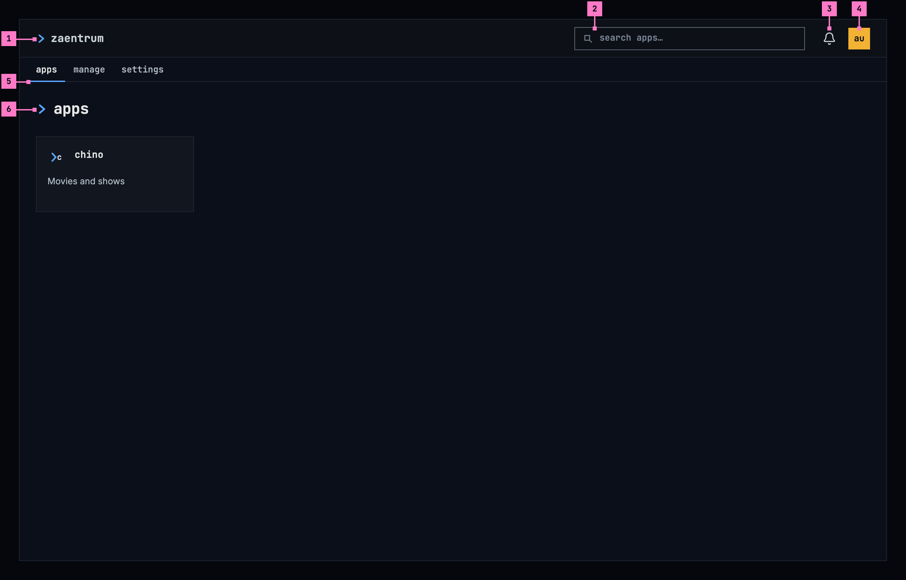

Figure 7: An admin's home page on a computer, at 1280 × 800, with apps the
current space.

1. **The product's name**, zaentrum, led by the design system's chevron, in
   the design system's top bar. It holds still, as everything in the bar does,
   and leads to the home page's first space.
2. **The search**, the design system's search field, “search apps…”. It finds
   tiles in every space, as the section Search across spaces sets out, and the
   / key puts the focus in it from anywhere on the page, except while the
   person types in another field.
3. **The bell.** Its number counts the notices the person hasn't read, and it
   opens them, as today.
4. **The avatar**, a square with the person's initials. It opens the design
   system's user menu: the person's name and, quieter, their email address;
   **settings**, for the people who may change the platform, which opens the
   settings space; and **sign out**, last and set apart. The portal has no
   account page and no help, so the menu offers neither.
5. **The spaces bar**, under the top bar, across the window: the spaces as
   words in the monospace face, lowercase, apps, manage and settings. The
   current space is brighter than the others, with a blue line under it.
6. **The space**: its title, the space's name after the chevron, which is the
   page's main heading, and its tiles. apps holds chino and every product
   installed next to it; here, chino alone.

The spaces bar is the design system's bar of spaces, a part of the shell it
plans, drawn here on its tokens: on the page's background, across the window,
with the 1 px rule of a row of tabs along its foot. Each space is a link, its
name in the monospace face at 13 px with 8 px of padding above and below and
12 px on either side, as a tab has, so the bar is 35 px high on a computer.
The current space's blue line, 2 px, is as wide as the name and its padding
and lies over the rule. The bar holds no counts and no badges, and it stays in
view with the top bar while the page scrolls. The first name, the space's title
and the tiles start in line, 24 px from the window's left edge, and the page is
as wide as the window. The space is the design system's home page component,
with the space's name as its title and without a search box of its own: the
search in the top bar is the one search.

The tiles are the design system's: a line icon, or a product's own mark, the
name in lowercase on one line, and a description in sentence case on at most
two. They take as many columns as fit at 224 px, so a name has room for 15
characters wherever the tiles stand. A tile opens its app as the registry says,
in the same tab or in a new one, as today.

## Spaces

A space is a page of tiles for one kind of work. Figure 8 shows the manage
space.

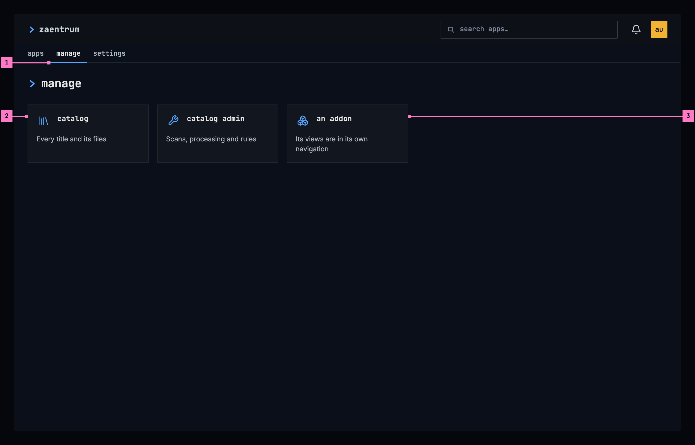

Figure 8: The manage space on a computer, at 1280 × 800.

1. **manage, the current space**, brighter, with the blue line under it.
2. **catalog and catalog admin**, the catalog's two apps: catalog to look
   through every title and its files, catalog admin for its scans, its
   processing and its rules.
3. **An addon's tile.** An addon joins manage with one tile when it is
   installed; its views are in its own navigation.

These are the rules for the spaces:

- **Three spaces, in this order, on every installation**: apps, for everyone
  signed in; manage, for the people who look after the library; settings, for
  the people who may change the platform. apps and manage are the registry's;
  settings is the portal's own, and comes last. An admin may add spaces in the
  registry, up to five in all, settings counted, each named with one word of
  eight letters at most, so the bar fits a phone held upright.
- **A space with nothing the person may open is hidden.** Someone who may open
  only one space sees no bar at all, because a bar of one is no choice: the
  top bar, then that space's title and tiles.
- **The current space** is brighter, with the blue line under it. The line, not
  the colour alone, says which one it is, and a screen reader hears it as the
  current page.
- **The home page opens on the first space the person may open**, apps, and
  the product's name leads back to it. Each space has an address of its own:
  the first space /portal/, and every space /portal/spaces/ followed by its
  key in the registry, such as /portal/spaces/manage. So a link, a reload or
  the browser's back brings people to it, and going to another space is a
  step in the browser's history. An address of a space the person may not
  open, or of one that isn't there any more, opens the first space. The
  window's title names the space, then the product: “manage · zaentrum”.
- **A space holds the tiles of its kind of work.** Where they are all of one
  kind, they stand under the space's title without a group's name; where they
  are of several kinds, each kind is one of the design system's tile groups,
  with its name. Of the three spaces, only settings has two kinds: platform,
  with registry, people and operator, and diagnostics, with logs, events,
  database and export (figure 10).
- **An addon joins a space; it never brings one of its own.** Its tile goes
  into the space its manifest names, if that space exists, or else into the
  one the admin chose when installing it. It brings one tile, its app's, as
  figure 8 shows.
- **A product that isn't installed has no tile**, and nothing says it is
  coming. A tile that can't be opened isn't shown.
- **No badge says who a tile is for**: only the people a tile is for see it.
  No badge or status square shows what the portal doesn't check.

Until an admin marks the platform as set up, the first-run checklist stands
above the first space's tiles, to admins only, as
[settings and setup](./settings.md) describes it.

## Search across spaces

The search in the top bar finds tiles in every space. Figure 9 shows it while
it holds “log”.

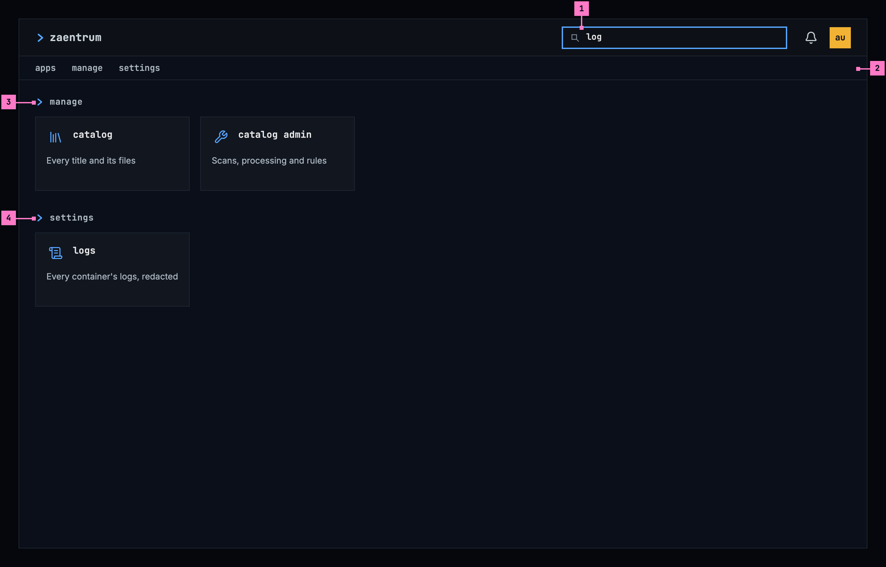

Figure 9: The search across spaces on a computer, at 1280 × 800, while it
holds “log”.

1. **The search**, with the words typed into it, and the focus.
2. **The spaces bar, with no space current**: the tiles below come from every
   space.
3. **manage**, a tile group named after its space, with the tiles of manage
   that match: catalog and catalog admin.
4. **settings**, the next space that has a match, with logs.

While the search holds words, the page shows every space's tiles in tile groups
named after their spaces, in the bar's order, and the design system's home
page narrows them as people type: a tile whose name or description holds what
was typed, whatever its case, stays, and a group left with none, here apps,
steps aside. A screen reader hears how many apps match: “3 apps match”, “1 app
matches”. When nothing matches, the page says so under the bar: “No apps match
“backup”. Try another word.”

Esc in the search clears it and brings back the space it was typed in, with
the focus on its first tile, and pressing a space in the bar clears the search
and opens that space. The search's words aren't part of the address. On a
phone the search is an icon in the top bar, which opens the design system's
search field across the bar.

## The home page on a phone

A screen or a window less than 600 px on its short side, a phone held either
way, has the phone's top bar: the search is an icon, and the spaces bar is 48
px high, so each space is a touch area of 48 px. Figure 10 shows the settings
space on a phone held upright and figure 11 the same space held sideways; the
last part of this section says what happens when the phone is turned.

### Held upright

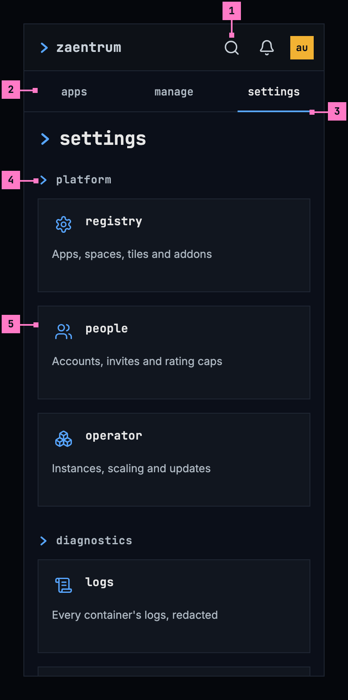

Figure 10: The settings space on a phone held upright, at 360 × 780.

1. **The search**, an icon. It opens the search field across the bar, with the
   keyboard.
2. **The spaces bar.** Less than 600 px wide, the spaces share the bar's width,
   each name in the middle of its share.
3. **settings, the current space**, with the blue line under its name and the
   name's padding.
4. **platform**, the first of the space's two tile groups. diagnostics follows
   further down.
5. **The tiles**, one under the other across the width, as the design system's
   grid has them where only one column fits.

The page scrolls under the two bars. Five spaces of eight letters still fit the
width of a phone held upright, each name whole.

### Held sideways

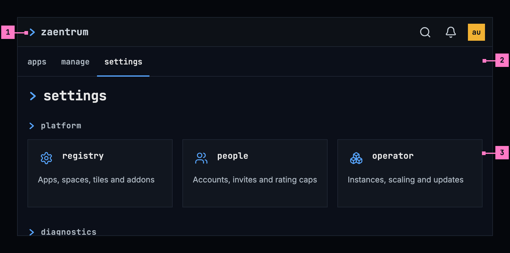

Figure 11: The settings space on a phone held sideways, at 780 × 360.

1. **The top bar**, 48 px high, so the page keeps more of the screen.
2. **The spaces bar**, the spaces one after another from the left, as on a
   computer: 600 px wide or more, they don't share the width.
3. **The tiles, three across**, as many as fit at 224 px.

### Turning the phone

Turning the phone keeps the space, the search's words and where the page was
scrolled to; the tiles take the columns the new width holds. The spaces bar
stays under the top bar either way, sharing the width while the screen is less
than 600 px wide and standing from the left when it is wider.

## For the keyboard and screen readers

- The spaces bar is a navigation landmark named “spaces”. Each space is a link,
  and the current one has aria-current="page".
- The Tab key moves through the top bar, then through the spaces one at a
  time, then to the tiles, which are one stop together: there the arrow keys
  move from tile to tile, across groups, as the design system's home page has
  it. In the bar the arrow keys do nothing.
- Enter opens the space that has the focus, and the focus stays on its link.
- The space's title is the page's main heading, and a tile group's name a
  heading under it. While the search holds words, no space is the current
  page, and each space's name heads its matching tiles.
- The product's name is a link named “zaentrum, home”, the avatar a button named
  after the person and what it opens, “Alex Urban, user menu”, and the bell
  keeps its name, “Notices, 2 unread”.

## Changes

Every difference between the section As deployed and the target is one change
in the table. A change names where it is built, the portal's web app or its
server, what they do today and the target, with the figure or the section that
sets it out; it is built as its row says, and nothing else changes with it.
Each change starts as proposed; once the owner approves it, it is built, one
change at a time. A target that starts with “Recommended” was an open decision,
or takes away something the portal has today.

| No. | Change | Where | Today | Target | Status |
|---|---|---|---|---|---|
| H.C1 | The design system 0.4.0 | Web | the package 0.3.0, a copy kept in the portal's code | 0.4.0, the version chino's web takes ([chino, chapter 2](../chino/frame.md)), so the shell and the apps it hosts are on one version; every part this page calls the design system's is that version's component | proposed |
| H.C2 | The design system's top bar | Web | the lockup, its cursor blinking; the bell; the account's name in a blue badge with a dot; **sign out** as a button of its own; no search; the same row on a phone (figures 1 and 2) | figure 7: the product's name led by the chevron, still, leading to the first space; the search (H.C11), a field on a computer and an icon on a phone; the bell as today; the avatar, a square with the person's initials, opening the design system's user menu with the person's name, their email address, **settings** for admins, which opens the settings space, and **sign out** set apart; no badge with the name and no sign out in the bar | proposed |
| H.C3 | Spaces, under the top bar | Web | one page: the heading, then every group the person may see, one under the other, in a column at most 1200 px wide in the middle of the window; one address, /portal/, and the window's title “zaentrum” (figure 1) | figures 7 and 8 and the section Spaces: the spaces bar under the top bar, across the window, 35 px high on a computer and 48 px on a phone, staying in view with the top bar; one space at a time, the design system's home page component with the space's name as its title and its tiles, in line with the first space's name, as wide as the window; the first space at /portal/ and each space at /portal/spaces/ and its key; the address of a space the person may not open, or of one that isn't there, opens the first space; someone with one space sees no bar; the window's title the space's name, then zaentrum; the bar a landmark named “spaces”, the current space with aria-current="page"; the first-run checklist above the first space's tiles | proposed |
| H.C4 | settings in the server's answer | Server, Web | the portal draws the settings group itself, for admins, after the registry's spaces; the server's answer doesn't hold it | Recommended: the server's answer holds settings last, for admins only, with the seven consoles as its tiles in their groups (H.C6), so the bar, the search and the states read one answer; the registry refuses a space with the key settings | proposed |
| H.C5 | No greeting and no foot | Web | “welcome back”, with “your spaces and apps” under it, a second-level heading, so the page has no main heading; “zaentrum · demo” at the foot, on every installation | neither: the space's title is the page's main heading (H.C3), and the page ends with its tiles | proposed |
| H.C6 | settings in two groups | Server, Web | one group of seven tiles | Recommended: platform, with registry, people and operator, and diagnostics, with logs, events, database and export, two of the design system's tile groups (figure 10) | proposed |
| H.C7 | The tiles' words | Server, Web | the descriptions lowercase, with “&” and “·”: “movies & shows”, “browse the catalog”, “register apps, spaces & tiles”, “accounts · invites · rating caps”, “instances · scale · update”, “container logs · redacted”, “kafka topology · live tail”, “curated tables · read-only”, “support bundle · redacted”; names stored with capitals, “Catalog”, “People” | the names and descriptions of the section Words, the descriptions in sentence case and the names stored as the tiles show them, in lowercase; the seed changes a row only while it still holds the seed's own words, so an admin's words stay | proposed |
| H.C8 | catalog admin, a name that fits | Server; catalog management's own heading | “Catalog Management”, “scan & settings”: at 18 characters the name is cut to one line with “…” on a tile narrower than 250 px, and the design system's tiles may be 224 px wide | Recommended: “catalog admin”, “Scans, processing and rules” (figure 8), 15 characters at most so it fits the narrowest tile; the app's own heading and its name in its top bar change with it | proposed |
| H.C9 | No badge or square the portal doesn't check | Server, Web | words stored in the registry, never checked: chino “ready” and a green square; tv and musig “soon” and a red square; Catalog and Catalog Management “admin” and a green square; every settings tile “admin”, operator a green square | Recommended: none of them, because no badge says who a tile is for and no square shows a state the portal doesn't check; the seed clears them where they are still its own, and a badge an admin sets in the registry still shows | proposed |
| H.C10 | A tile that can't be opened isn't shown | Server | a disabled tile, the tile of a disabled app or one without a destination is in the answer and shown faded, such as tv and musig with “soon” | left out of the answer, as a tile the person may not see; a space left with nothing is left out with it | proposed |
| H.C11 | The search across spaces | Web | no search on the home page | figure 9 and the section Search across spaces: the design system's search field in the top bar, “search apps…”; while it holds words, every space's tiles in tile groups named after their spaces, narrowed by the design system's home page; no space current in the bar; Esc clears it and brings back the space; a space pressed in the bar clears it; when nothing matches, “No apps match “backup”. Try another word.”, where the design system's example adds “or press Esc in the search box to clear it”, which a phone can't do | proposed |
| H.C12 | Five spaces at most | Server | the registry takes any number of spaces, with any name | the registry takes four spaces at most, settings being the fifth on the home page, each named with one word of eight letters at most; it refuses more, or a longer name, with the words of the section Words | proposed |
| H.C13 | An addon joins a space | Server | an addon's manifest may bring a space of its own, which the portal creates and removes with the addon, and a tile for each of its views | Recommended: the portal never creates a space for an addon: its tile goes into the space its manifest names if that space exists, or else into the one chosen at install, and it gets one tile, its app's (figure 8); the documentation for addon authors changes with it | proposed |
| H.C14 | Loading: grey blocks | Web | the loader and “loading your launchpad…”, at once, under the heading (figure 4) | figure 12: nothing for 0.4 seconds, then grey blocks in the shape of a space's title and tiles; a screen reader hears “Loading your apps” once | proposed |
| H.C15 | Couldn't load: say why | Web | “couldn’t load your launchpad:” and the raw error, in red, such as “Failed to fetch”; no way to try again (figure 5) | figure 13: the design system's empty state of its error kind, large, “couldn't load your apps”, the reason by cause, **try again**, and the status under **details** | proposed |
| H.C16 | Nothing to open | Server, Web | for an account that may see no tile, the server writes the list of spaces as null, and the page goes blank, top bar included (figure 6) | the server writes an empty list, and the page shows figure 14 under the top bar | proposed |

## States

The home page is drawn in figures 7 to 11 with its tiles. Figures 12 to 14 show
the states before and instead of them.

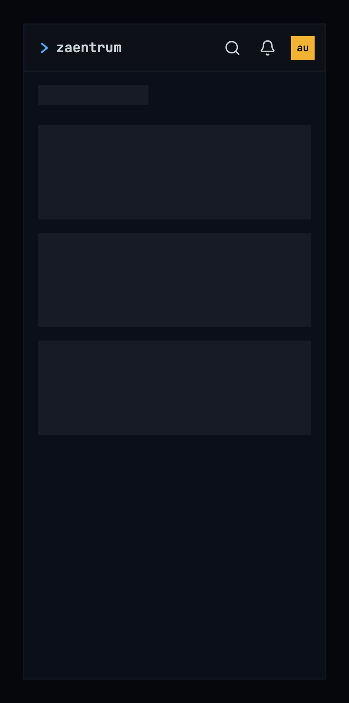

Figure 12: The home page loading, on a phone held upright, at 360 × 780.

While the home page loads, it shows nothing for the first 0.4 seconds, so a
quick answer doesn't flash a loading state, and then grey blocks in the shape
of a space's title and its tiles, as the design system's
[loading and progress](https://nalet.github.io/design-system/patterns/loading-and-progress/)
pattern has it for a page. The spaces bar comes with the tiles, because only
the answer says whether there is more than one space. A screen reader hears
“Loading your apps” once.

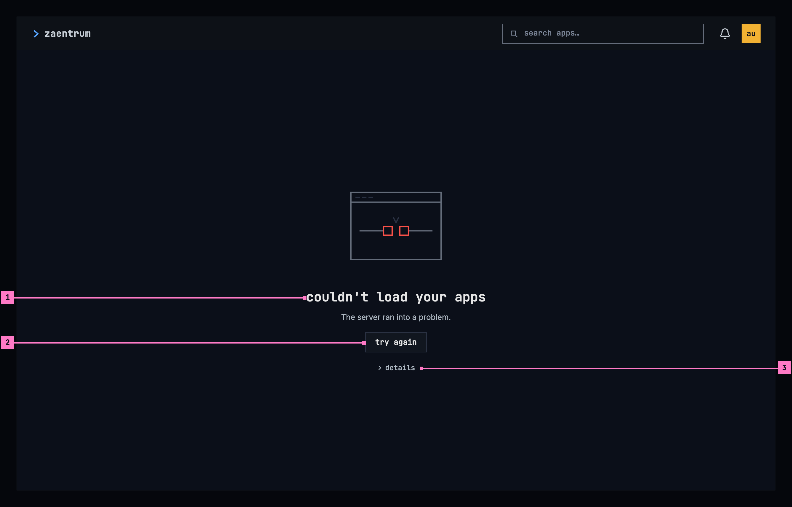

Figure 13: The home page when the spaces couldn't load, on a computer, at 1280
× 800.

1. **What couldn't load, and why**, in the design system's empty state of its
   error kind, at its large size: the title “couldn't load your apps”, and the
   reason by cause under it, here that the server ran into a problem.
2. **try again**, which asks for the spaces again and shows the loading state
   while it waits.
3. **details**, closed at first, with the status and its reason phrase, “HTTP
   500 Internal Server Error”, for the people who fix things.

The spaces and their tiles come in one answer, so a space that couldn't load,
the first one or one opened at its own address, shows this page in its place,
without the spaces bar. The reason is the one the design system's
[empty states](https://nalet.github.io/design-system/patterns/empty-states/#when-it-couldnt-load-say-why)
give for the answer's status.

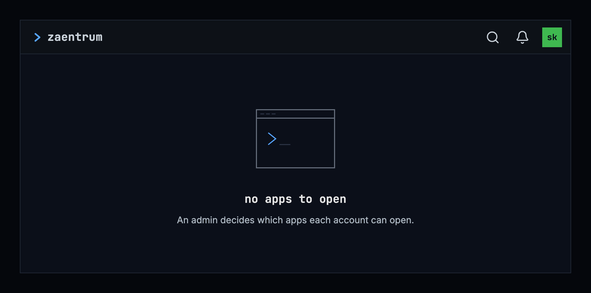

Figure 14: Nothing to open, on a phone held sideways, at 780 × 360.

An account that may open no tile at all, one that isn't an admin, since an
admin always has settings, sees the design system's empty state of its
nothing-yet kind under the top bar: “no apps to open”, and “An admin decides
which apps each account can open.” It has no button, because nothing on the
page can change it.

| State | What the home page shows |
|---|---|
| Loading | Figure 12 |
| Couldn't load: no answer | Figure 13, with “Can't reach the server.” |
| Couldn't load: the server ran into a problem | Figure 13 |
| Couldn't load: the server is busy | Figure 13, with “The server is busy.” |
| Couldn't load: the server didn't accept the request | Figure 13, with “The server didn't accept the request. Check for an app update.” |
| Signed out | no empty state: the portal signs the person in again and comes back to the same address, as today |
| Nothing to open | Figure 14 |
| No matches for the search | under the spaces bar, the design system's home page's message: “No apps match “backup”. Try another word.” |
| One space only | no spaces bar: the top bar, then the space's title and tiles |
| An address of a space the person may not open, or that isn't there | the first space |
| The first run, for an admin | the checklist above the first space's tiles, until an admin marks the platform as set up |
| The admin role through another client | as today, the sentence under the first space's tiles that says why the consoles stay closed |

## Words

| Where | Text |
|---|---|
| The top bar | the product's name zaentrum, for a screen reader “zaentrum, home” · the search's placeholder “search apps…”, its name “search apps” · the bell “Notices”, “Notices, 2 unread”, as today · the avatar, for a screen reader “Alex Urban, user menu” |
| The user menu | the person's name and email address · settings, for admins · sign out |
| The window's title | the space's name, then the product's: “apps · zaentrum”, “manage · zaentrum” |
| The spaces bar | the landmark “spaces” · apps · manage · settings |
| A space's title | its name: apps · manage · settings |
| settings' groups | platform · diagnostics |
| The tiles, name and description | chino “Movies and shows” · catalog “Every title and its files” · catalog admin “Scans, processing and rules” · registry “Apps, spaces, tiles and addons” · people “Accounts, invites and rating caps” · operator “Instances, scaling and updates” · logs “Every container's logs, redacted” · events “The event bus and a live tail” · database “Chosen tables, read-only” · export “A support bundle, redacted” |
| An addon's tile | its own name and description, from its manifest, in sentence case as the design system writes a description |
| The search | the groups named after their spaces · for a screen reader “3 apps match”, “1 app matches” · No apps match “backup”. Try another word. |
| Loading, for a screen reader | Loading your apps |
| Couldn't load | couldn't load your apps · Can't reach the server. · The server ran into a problem. · The server is busy. · The server didn't accept the request. Check for an app update. · try again · details · “HTTP 500 Internal Server Error” |
| Nothing to open | no apps to open · An admin decides which apps each account can open. |
| The registry, refusing a space | A home page has five spaces at most, settings included. · A space's name is one word of eight letters at most. |
