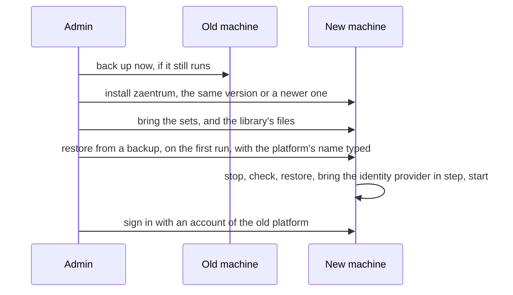

# Running the platform

This page specifies how the people who run zaentrum are told that something
is wrong, how the platform sends mail, how its databases are backed up,
restored and moved to another machine, and how an admin sees what takes the
room on its volumes. It covers the platform's resource, the operator,
portal-api, the catalog's writer, the portal's pages and the CLI. The pages
for the platform's parts, its logs, its events, its database and the support
bundle stay as they are built.

The section As built describes what the platform does today. The sections after it are
the target, and the section Changes lists every difference between the two as a numbered
change. Only a change the owner has approved is built, one change at a time; anything no
change names stays as it is built.

## Purpose

Somebody runs zaentrum for a household: most often one person, an admin, who
is seldom a developer of any part of it. This page is for what that person
needs once the platform is installed: to learn of a failure without looking
for it, to have the platform send the few mails a household needs, to know
that the databases are backed up and how to get them back, to take the
platform to another machine, and to see what fills its volumes.

It serves the goal [Run it oneself](../goals/README.md#run-it-oneself), and
through it every goal that needs a platform that runs. Four qualities of the
goals are measured by what this page specifies:

| The platform has to | Today | With this page |
|---|---|---|
| tell whoever runs it of a failure before the household notices | a failure is shown in the portal to whoever looks; nothing is sent | five alerts, in the portal's bell for admins and by mail |
| be back after a dead disk, with little lost | the bundled databases restore into the install that made them | a backup restores into any install of its version or a newer one, from the portal and the CLI |
| lose nothing of the library | the databases: up to a day; the files: what their storage keeps | the same, said on a page: where the backups are, how old the newest is, and what only the library's own storage keeps |
| never be left broken by an update | it checks itself after each update; nothing says how an update is undone | an alert when an update fails; in a cluster a backup before each update, and the way back in the documentation. On one machine the updater of [Installing and updating](../platform/install.md) undoes it |

It answers five [expectations](../capabilities/expectations.md#run-it-oneself):
to back up and restore, to move the server to another machine, to be told when
something is wrong, to see how much room the library takes and, in part, to
reach people outside the app. Two decision records carry the reasons:
[ADR-0019](../../docs/adr/0019-mail-and-alerts.md), mail and alerts, and
[ADR-0020](../../docs/adr/0020-backup-restore-and-moving.md), backup, restore
and moving.

## As built

This section says what the platform does as of 15 November 2026, as the code
of each repository's main branch has it.

### The pages and commands for running the platform

The portal's settings group has seven tiles, for admins alone
([home page](./home.md)). Five of them are for running the platform:

| Page | Address | What it does | Its routes in portal-api |
|---|---|---|---|
| operator | `/portal/operator` | the platform's version, phase, channel and update mode; every part with its image, replicas, state and restarts; scale and restart; apply an update; the self-check's result and **verify now**; the operator's own controller | `GET` and `PATCH /api/portal/operator`, `POST /api/portal/operator/apply-update`, `POST /api/portal/operator/verify`, `POST /api/portal/operator/instances/{name}/scale`, `POST /api/portal/operator/instances/{name}/restart` |
| logs | `/portal/logs` | a part's container logs, credentials scrubbed, as they come or as a file | `GET /api/portal/debug/pods`, `GET /api/portal/debug/logs` |
| events | `/portal/events` | the event bus's topics and consumers, and the latest events | `GET /api/portal/debug/kafka/topology`, `GET /api/portal/debug/kafka/events` |
| database | `/portal/database` | seven chosen tables of the catalog's and the portal's databases, read-only | `GET /api/portal/debug/db/tables`, `GET /api/portal/debug/db/rows` |
| export | `/portal/export` | a support bundle as one file, credentials scrubbed | `GET /api/portal/debug/support-bundle` |

The first-run checklist, “Set Up Your Server”, stands on the home page for
admins until one marks it done. It has five steps: Metadata, Library,
Processing, Devices and People. The bell in the top bar holds notices: what an
addon tells one person.

The CLI, `zae`, does the same from a terminal: `zae platform status`,
`controller`, `update`, `restart`, `scale` and `verify`, `zae setup`,
`zae debug logs`, `events` and `bundle`, and `zae doctor`, which checks an
instance from outside. It reaches the platform through portal-api's routes
with a sign-in of its own; it never talks to the cluster.

None of these pages or commands shows a backup, a volume or a certificate, and
none sends anything.

### No mail is sent

- **Nothing sends mail.** No repository holds code that talks to a mail
  server, and the platform's resource has no field for one.
- **An invite is handed over by hand.** An admin adds a person on the People
  page with a name, a username, a role and a rating cap; no address is asked
  for. The page then shows the person's invite link once, in a dialog, with
  “Send Mia this link: with it they choose their own password, then sign in on
  any app with their username.” and **Copy Invite Link**. The link works once,
  for 7 days (`PORTAL_INVITE_TTL`).
- **A forgotten password needs an admin.** The bundled identity provider's
  realm is made with password reset allowed, so its sign-in page shows “Forgot
  password?”. The realm has no mail server, so the link that page promises
  cannot be sent. The person asks an admin, who makes them a new invite link
  on the People page, or resets the password in the identity provider's own
  console.
- **The first admin has a placeholder address**, at the domain
  `zaentrum.local`, from the realm's import.
- **The repository `notifications` is an idle scaffold.** Its README calls it
  a service that hands pushes to Apple's and Google's push services and to
  browsers. Its server answers a health check and a metrics route and nothing
  else; every sender in it returns “not implemented”. The operator's chart
  does not hold it, and no other repository names it.

### What is known, and who is told

The operator writes what it knows into the status of the platform's resource,
every 30 seconds:

| In the status | Says |
|---|---|
| `phase` | `Reconciling`, `Progressing`, `Ready`, `Degraded` when a rollout has given up, `Restoring`, `Error` |
| `components[]` | each part's name and image and whether it is ready; not since when |
| the condition `Ready` | why not: `ComponentsNotReady`, `RolloutStalled` with the parts' names, `Restoring` |
| `verification` and the condition `Verified` | the self-check after each update and on request: the checks of `zae doctor` from outside. Its check `tls` warns when the certificate it is served ends within 14 days |
| the condition `TLS` | how the hosts are served. With a certificate of the platform's own, the date it ends on is inside the sentence |
| `backup` and the conditions `Backup` and `Restore` | the newest dump, the last failure, the dumps kept, and where a restore stands |
| `currentVersion`, `availableUpdate` | the version applied, and a newer one on the channel |

The portal's operator page shows the phase, the parts and the self-check.
portal-api reads neither the backups nor the certificate from the status.
Nothing compares any of it with a limit, and nothing is sent: an admin learns
of a failure by opening the page. The platform itself puts nothing into the
bell: a notice comes from an installed addon, is for one person, and cannot
be addressed to the admins.

What the operator may read in a cluster is what its role gives it: it reads
and writes Deployments, Jobs, CronJobs, Secrets, ConfigMaps and claims, and
it reads pods. So it knows the size a claim asks for and the size it is bound
to, and it reads the certificate's Secret on every pass. It holds no
permission on nodes. How full a volume is, only its node knows, and the
operator cannot ask it.

### Backups and restoring today

- **What is backed up.** Where the bundled Postgres keeps its data on a
  claim, as every new install does, a scheduled job dumps the four platform
  databases while the platform serves: `chino` (watch progress, history,
  watchlists and likes), `katalog` (the catalog), `keycloak` (the bundled
  identity provider: accounts, password hashes, roles, clients) and `portal`
  (the registry, addons, invites, notices, the setup mark).
- **When.** Every day at midnight (`spec.backup.schedule`, `@daily`), in the
  time zone of the cluster. A run that was missed while the cluster was down
  still runs within six hours.
- **Where.** A dump is a directory on the claim `backups` (`spec.backup.size`,
  5Gi; or an existing claim named in `spec.backup.claimName`), named after the
  moment it began, in UTC, such as `2026-11-15T00-00-05Z`. It holds
  `globals.sql` (the database's roles but the superuser), one file for each
  database in pg_dump's custom format, and `SHA256SUMS`. The newest 7 stay
  (`spec.backup.retention`). The claim is kept when the platform is deleted.
- **What a dump does not say.** Nothing in it names the platform or the
  version that made it, and it does not hold the platform's resource.
- **What the status says.** `status.backup` has `lastSuccess`, `lastDump`,
  `lastFailure`, the names of the `dumps` and the last `job`. The condition
  `Backup` is `Succeeded` with the dump's size and the claim's free space,
  `Failed` with the run's reason, `Disabled`, or `Scheduled` before the first
  run.
- **Where nothing is backed up.** An install whose Postgres still runs on a
  volume that goes with its pod, and an install with external databases
  (`databases.mode: external`).
- **Restoring.** The annotation `zaentrum.io/restore-request` on the
  platform's resource, with a dump's name, asks for one restore. The operator
  stops every part that uses the database, portal-api and the identity
  provider among them, and suspends the backups; a job makes sure the dump is
  whole and refuses it otherwise, changing nothing; it recreates each
  database; the parts start again and the realm job runs over the restored
  realm. The phase is `Restoring` meanwhile and the platform is down.
  `status.backup.restore` and the condition `Restore` say where it stands:
  `Stopping`, `Running`, `Succeeded`, `Failed` or `Refused`. The restore
  refuses a dump that holds any file besides the roles, the four databases
  and the checksums.
- **Who can do it.** Whoever may change the resource with `kubectl`. The
  portal and the CLI show no backup and start no restore.
- **What a dump leaves out.** The platform's Secrets, the library's files,
  the event broker's log and the cache.

### Another machine

The operator's README describes one way, by hand: keep the platform's six
generated Secrets as a file, apply them in the new namespace before the
resource, bring the claim with the dumps along, name it in
`spec.backup.claimName`, and restore with the annotation. Without the old
Secrets the restored identity database does not fit the new install: it
holds the old password of the identity provider's own admin, which the
operator's jobs sign in with, and the old secret of the `zaentrum-manager`
client.

The one-container install keeps all three claims in one Docker volume. Its
documentation tells the admin to copy the dumps and the Secrets off the
machine by hand. A container that is replaced starts an empty platform,
unless it was started on a named volume under a fixed host name
([persistence](../../docs/self-hosting.md#persistence)).

Neither the portal nor the CLI has a part in any of it.

### Room

- The catalog keeps, for each title, the size of its originals on disk and
  the size of its package, and for each extra the size of its file and of its
  package. The catalog console's list shows a title's two sizes, and its
  rules report adds them up for the titles that break a rule. No query adds
  up the library, and no screen shows a total.
- No part asks a filesystem how much room is left, but the packager for its
  temporary folder, and the backup's run for the backups' claim: the `Backup`
  condition repeats that figure in its sentence.
- The first-run checklist names the claim and the folder of the library, not
  their size.

### The library's files and the catalog

- A library is in one of two layouts, by the catalog's setting
  `library.layout`: `legacy`, the default, or `v2`. Only in the `v2` layout
  does each title's folder carry its record: its identity, its texts and
  images as the catalog last wrote them, its sources, versions and packages,
  each with checksums ([the record](../../docs/library/record.md)).
- A scan reads no record. It walks one folder, the arrivals in the `v2`
  layout, and takes every video and audio file it does not know by its path
  or its size and hash as a new title. Over an empty catalog it brings back
  the titles whose originals are still in that folder, as new titles to be
  packaged again; it finds no package.
- A rebuild of the catalog from the records is a tool of the schemas
  repository, which the migration to the `v2` layout uses to compare a tree
  with the catalog. Nothing in the platform starts it: no command, no route,
  no screen.
- What the record does not hold, by the catalog's code: a title's age rating,
  the single fields a person locked, a hold on an original, track languages
  set by hand, a chosen subtitle default, the catalog's settings and rules,
  and the log of what was deleted. The accounts, the watch history and the
  lists are in other databases and in no file of the library.

## Mail

Mail is the platform's one way to reach somebody outside its apps. It goes
through an SMTP server the admin names. Without one the platform sends
nothing, everything else works as today, and each screen that would have sent
a mail says so.

### The settings

Mail is set in the platform's resource, with the same names in the chart's
values:

| Field | Values | Default |
|---|---|---|
| `spec.mail.host` | the name of an SMTP server | none: no mail is sent |
| `spec.mail.port` | 1 to 65535 | 587 with `starttls`, 465 with `tls`, 25 with `none` |
| `spec.mail.encryption` | `starttls`, `tls`, `none` | `starttls` |
| `spec.mail.from` | the sender's address | none; the resource is refused when `host` is set and this is not |
| `spec.mail.fromName` | the sender's name as a mail program shows it, at most 60 characters | `zaentrum` |
| `spec.mail.user` | the name the platform signs in to the server with | none: it does not sign in |
| `spec.mail.secretName` | a Secret in the platform's namespace with the key `password`, the password of `user`; a name a Secret can have | none; the resource is refused when `user` is set and this is not |
| `spec.mail.alertsTo` | at most 10 addresses that get every alert mail | none |

Mail is **set up** when `host` and `from` are set. The operator then:

1. gives portal-api the settings as environment variables
   (`PORTAL_MAIL_HOST`, `PORTAL_MAIL_PORT`, `PORTAL_MAIL_ENCRYPTION`,
   `PORTAL_MAIL_FROM`, `PORTAL_MAIL_FROM_NAME`, `PORTAL_MAIL_ALERTS_TO`,
   `PORTAL_MAIL_USERNAME` from `user`, `PORTAL_MAIL_PASSWORD` from the Secret,
   and `PORTAL_MAIL_SECRET`, the Secret's name, so that portal-api can tell a
   password that changed without reading any Secret) and the
   platform's public address (`PORTAL_PUBLIC_URL`), which the links in a mail
   start with, and starts portal-api again when one of them changes or the
   Secret named appears;
2. with the bundled identity provider, has the realm job write the server,
   the port, the encryption, the sender, the user and the password into the
   realm's mail settings, and switch the realm's password reset on; without
   mail the job clears them and switches the reset off. The job reads the
   realm's mail settings as they are after that step and switches by them: on
   while they name a server, off while they name none. The chart's realm is
   made with the reset off, so a new platform offers none before the job has
   run. The job runs again when the mail settings change and when the Secret
   named appears. Each of its writes changes what it names and leaves every
   other setting of the realm at the value it had, one set in the identity
   provider's console among them. The realm's mail settings alone are the
   platform's: a write replaces them whole;
3. says in the condition `Mail` where it stands: `NotSetUp`, `SecretMissing`
   when the Secret named is not there or lacks its key, or a user has none
   named where the resource's rule did not run, `Configured`. While the Secret
   is missing the realm's mail settings stay as they were, and the password
   reset with them: on where a server is still in the realm, off where none
   is.

The user's name is in the resource, where an admin can read it; the password
alone is in the Secret, which portal-api writes and never reads. So a change
of the user keeps the password that is there, and a change of the password is
a new Secret with a new name.

Mail is **ready** once the condition is `Configured` and the portal-api that
answers runs with the settings, with the password where a user is set, and
with the public address. A link in a mail
and the platform's name in it come from the public address alone, never from
the request that asked for the mail: a portal-api without a full public
address, a scheme and a host, sends none. Where portal-api cannot read the
resource it sends no mail either, and gives the cluster's refusal as the
reason.

A platform that the operator does not run has no resource. There mail is set
up when the server, the sender and the public address are in portal-api's own
settings, and it is ready with that.

### What is sent

| Mail | Sent by | To | When |
|---|---|---|---|
| an invite | portal-api | the address of the person's account | an admin adds the person, or makes them a new invite link, with **send the link by mail** on |
| a password reset link | the bundled identity provider | the address of the person's account | the person asks for it on the sign-in page |
| an alert, and its end | portal-api | every admin who has an address, and the addresses of `spec.mail.alertsTo` | an alert starts or ends (section Alerts) |
| a test mail | portal-api | the address the admin names | **send test mail** on the mail page |

Nothing else is sent. What an addon tells a person stays in the bell.

Every mail portal-api sends is plain text in UTF-8, to one address, with the
headers `From`, `To`, `Subject`, `Date`, `Message-ID` and
`Auto-Submitted: auto-generated`. The password reset has the identity
provider's form: one mail to one address, with a text part and an HTML part
that carry the same lines, a paragraph each, the link in the HTML part marked
`rel="nofollow"`, and no `Auto-Submitted` header. No mail carries a picture
or anything that reports whether it was opened. The words are in the section
Words.

An **address**, wherever one is typed or set, is one bare address of at most
254 characters: no name, no angle brackets, no line break, and a domain that
is a host name of at least two parts. Its letters are ASCII. An address with
accented or non-Latin letters is refused, because not every mail server
carries one.

### Sending

- portal-api opens one connection for each mail: 10 seconds to connect, 30
  seconds in all.
- With `starttls` the server has to offer encryption after the greeting; a
  server that does not is refused, never spoken to in the clear. With `tls`
  the connection is encrypted from the start. With `none` nothing is
  encrypted, and the mail page warns. The server's certificate is checked
  against the authorities the image trusts; there is no setting to skip the
  check.
- portal-api signs in when a user is set, and only then.
- An admin may name any server portal-api can reach, one on the home network
  or inside the cluster among them. portal-api speaks SMTP to it and nothing
  else, and of its answer it repeats only an SMTP reply, 300 characters at
  most.
- The identity provider sends its own mails, the password reset among them,
  through the same server. With `tls` they are encrypted as the platform's
  are. With `starttls` the identity provider asks for encryption and goes on
  without it where the server offers none: it cannot be told to refuse. The
  mail page says so beside “STARTTLS”, and “TLS from the start” is the value
  to choose where the mail server has it.
- An invite and a test mail are sent while the admin waits: the answer says
  whether the server took the mail, and why not. An alert mail that fails is
  tried again after 5 minutes, three times in all, and then given up.
- portal-api writes into its log that a mail of a kind was sent or refused,
  never an address and never the text.

### People and addresses

A person's address is the address of their account in the identity provider.
One address belongs to one account.

- **On the people page** the form to add or change a person has the field
  **email**, optional. portal-api refuses an address another account has, and
  one that is not an address. An account that administers the identity
  provider itself is changed in the provider's console, as today, its address
  included.
- **A person's own address** is theirs to set on the identity provider's
  account page ([people](./people.md)). The mail page links the admin who is
  signed in to it. An account the people page does not change, such as the
  first admin's of an install made with one, gets its address there.
- **A placeholder address**, one at the domain `zaentrum.local` as the
  realm's import gave the first admin, counts as no address: nothing is
  mailed to it, the people routes answer its account without an address, and
  the form refuses one that is typed. The identity provider does not know it
  for one: a password reset asked for such an account is handed to the mail
  server, which cannot deliver it.
- **With an external identity provider** the platform keeps no addresses.
  Invites and password resets are the provider's own, and alert mail goes to
  `spec.mail.alertsTo` alone.

When an admin adds a person, or makes them a new invite link, the dialog has
the switch **send the link by mail**. It is shown when mail is ready and the
person has an address, and it is on at first. portal-api then sends the
invite and still answers the link, which the page shows once, as today.

| Route | Takes | Answers |
|---|---|---|
| `POST /api/portal/people` | as today, and `email` (optional), `sendInvite` (true or false, default false) | as today, and where `sendInvite` is true `mail`: `sent`, `not-set-up`, `no-address` or `failed`, with `mailError`, the reason: its code, its values and its sentence, when it failed |
| `PATCH /api/portal/people/{id}` | as today, and `email`; an empty one removes the address | the person |
| `POST /api/portal/people/{id}/invite` | `send` (true or false, default false) | the link as today, and where `send` is true `mail` and `mailError` as above |

### The sign-in page

With mail ready and the bundled identity provider, the sign-in page shows
“Forgot password?” as today. It leads to the identity provider's own page,
which mails a link that works for the realm's time for such a link: 5
minutes today. The mail names the time the realm has, so it stays true where
somebody changes it. Without mail the page shows no link, and under the
form: “Forgot your password? Ask an admin for a new invite link.”

The pages after “Forgot password?” are the identity provider's own, in its
words and under the realm's name: the one that asks for the username or the
address, and the one that answers “You should receive an email shortly with
further instructions.” for every account. The chart words the sign-in page
and the mail, not them.

### The mail page

The settings group gets a tile, **mail**, “Mail server, and what is sent”,
which opens `/portal/mail`. The page is a form in four parts:

1. **server**: the fields **server**, **port**, **encryption** (the design
   system's select: “STARTTLS”, “TLS from the start”, “none”), **user** and
   **password**. The password is never shown: once one is kept the field is
   empty with “A password is kept. Type a new one to replace it.” under it.
   While “STARTTLS” is chosen and the platform runs the identity provider,
   the hint under **encryption** reads “A password reset mail goes out
   unencrypted if the mail server offers no encryption. Choose TLS from the
   start where the server has it.”
2. **sender**: the fields **address** and **name**.
3. **what is sent**: three rows, “Invite links”, “Password reset links” and
   “Alerts”, each with one sentence, and the design system's switch **mail
   alerts** on the third (`spec.alerts.mail`).
4. **alerts go to**: a table with the columns **who** and **address**: every
   admin whose account is enabled, with their address or “no address”, then
   the further addresses.
   Under it are the link **change your address**, which opens the identity
   provider's account page for the admin signed in, and the field **further
   addresses**, which takes up to 10.

The buttons are **save** (emphasized), **send test mail** (standard) and
**remove mail settings** (quiet). **send test mail** asks for an address in a
dialog, with the admin's own filled in. **remove mail settings** asks first,
in a dialog with a danger button.

**save** writes the settings into the platform's resource. A new password is
written into a new Secret, which the resource then names, the way an addon's
secret values are kept. portal-api labels that Secret `zaentrum.io/mail`, and
the operator removes one with the label that the resource has not named for
10 minutes, counted from when the operator first sees it unnamed; a restart of
the operator starts the count again. The page says “Applying the settings…” until mail is ready,
about a minute.

| Route | Does |
|---|---|
| `GET /api/portal/mail` | the settings without the password, `passwordSet`, `setUp`, `ready`, `secretMissing` (the condition `Mail` says so), `runByOperator` (false where the operator does not run the platform), `identity` (`bundled` or `external`), `alertMail`, and `recipients`: each admin's name and address, and the further addresses |
| `PUT /api/portal/mail` | takes `host`, `port`, `encryption`, `from`, `fromName`, `user`, `password` (left out: the one kept stays) and `alertsTo`; answers the resource's new generation |
| `DELETE /api/portal/mail` | removes `spec.mail` |
| `POST /api/portal/mail/test` | takes `to`; sends the test mail; 200, or 502 with the reason as a sentence |

All four are for admins.

A value of the wrong kind in a body, a port that is no whole number for
instance, is refused with its field's sentence and code like any other value,
and a port of 0 is no port. No setting takes a control character: the resource
refuses one in every mail field, and portal-api refuses it before it writes.
Where the cluster does not know mail settings, as under an operator from
before them, **save** writes nothing, keeps no Secret and says so.

A code has one sentence. Where two pages word the same case differently, each
has a code of its own that starts with the page's name (`mail_`, `alerts_`,
`backups_`, `storage_`); a case worded the same everywhere keeps one code. A
refusal's values are numbers and names as they are, not all of them strings.

## Alerts

An alert says that one of five things is wrong. The list is fixed. Each alert
shows in the portal's bell for admins, and where mail is set up it is mailed
when it starts and when it ends.

### The five alerts

| Alert | It starts when | Its setting | Default | Values |
|---|---|---|---|---|
| A part is not ready | a part of the platform has not been ready for this many minutes | `spec.alerts.partNotReadyMinutes` | 10 | 1 to 1440 |
| A volume is almost full | a volume is at least this full, in per cent | `spec.alerts.volumeFullPercent` | 90 | 50 to 99 |
| The certificate ends soon | the platform's certificate ends within this many days, or has ended | `spec.alerts.certificateDays` | 14 | 1 to 90 |
| No good backup | the last backup failed, or the newest good one is older than this many days | `spec.alerts.backupAgeDays` | 2 | 1 to 30 |
| An update failed | a rollout has given up, or the self-check after an update failed; on one machine, the updater went back or could not start | none | | |

`spec.alerts.mail` (true or false, default true) says whether alerts are
mailed. Every alert shows in the bell whatever it says. The resource holds
no defaults: a setting left out means its default, which portal-api applies.
A value outside its range is refused by the cluster, in the cluster's words.

### Where each fact comes from

Every fact is in the status of the platform's resource, which portal-api
reads as itself; on a one-machine install one more is in the updater's
report, which portal-api reads the same way. portal-api asks no other
service: it reaches the catalog's writer only with the sign-in of an admin,
and an alert is checked while nobody is signed in. The addresses an alert is
mailed to it reads from the identity provider with its own client, as the
people page does.

| Alert | The status it reads | Who writes it |
|---|---|---|
| A part is not ready | `status.components[]`: `ready` and `notReadySince` | the operator, from the parts' Deployments, on every pass |
| A volume is almost full | `status.storage.volumes[]`: `sizeBytes`, `freeBytes`, `filesystem` | the operator, from the measuring jobs (below) |
| The certificate ends soon | `status.certificate.notAfter` | the operator, from the Secret of `spec.tls`, on every pass |
| No good backup | `status.backup.lastSuccess`, the condition `Backup` | the operator, from the backups' runs, as today |
| An update failed | the condition `Ready` with the reason `RolloutStalled`, and `status.components[].stalled`; `status.verification`; on a one-machine install the updater's report ([Installing and updating](../platform/install.md), I.C17) | the operator, as today; the updater |

The operator adds these to the status:

- **`status.components[].notReadySince`**: the time a part was first seen
  not ready while it is meant to run. It is absent while the part is ready,
  and while the part is meant to run at 0: one an admin stopped, and every
  part the operator keeps stopped for a restore.
- **`status.components[].stalled`**: true while the part's rollout has given
  up, and absent otherwise. A part can be ready and stalled at once: what ran
  before still serves.
- **`status.certificate`**: `notAfter`, the time the certificate ends, and
  `names`, the names it is for. It is there when the platform has a
  certificate of its own (`spec.tls`) that can be read, and absent otherwise.
  It is there whenever the Secret holds a certificate that can be read,
  whatever else the condition `TLS` says of it.
- **`status.storage`**: what the measuring jobs found.

### Measuring

The operator cannot see how full a volume is. So each volume is measured by a
short job that mounts it:

- The chart has one measuring job for each claim the platform uses: the
  library's (`media`), the backups', and the event broker's where it has a
  claim. Each runs every hour, started by the operator, never two runs of one
  job at once, mounts its claim read-only, and reports the filesystem's size, what an ordinary
  writer can still use of it, and the filesystem's id. The backups' hourly
  run is skipped while a backup runs.
- The library's job also asks the bundled Postgres for the size of each
  platform database, and for the size, the free space and the filesystem id
  of the volume its data is on: the database server reads those itself, for
  its superuser. A database server without a claim of its own has no volume
  listed, and with external databases nothing is asked. Where the database
  server may not read its own volume, that is no failure: the volume is
  listed with the size its claim asks for alone, it raises no alert, and the
  condition says so.
- The backups' job also lists the sets on the claim, the newest 30 with
  their size, the version in their `backup.json`, whether they are whole (the
  checksums file is there) and whether this platform made them: the `uid` in
  the set's `backup.json` is this resource's. A set without `backup.json` has
  no version, and nothing says who made it. A report holds 4096 bytes at
  most: where 30 sets do not fit, the job lists fewer, and it always says how
  many the claim holds. Asked for one set by name, it reports that set as
  well, however old it is. The backups' claim is measured wherever it is
  there, with backups on or off; where there is none, it is not among the
  volumes and no set is listed. A set whose `backup.json` cannot be read, or
  names a version of more than 128 characters, is listed without a version.
- A claim that is not bound yet is not measured: measuring never decides
  where a volume is made. It is listed with the size it asks for.
- The operator reads each job's result as it reads a backup's, and writes:

  | Field | Holds |
  |---|---|
  | `status.storage.volumes[]` | `name` (`media`, `postgres-data`, `backups`, `kafka`), `claim`, `requestBytes` (the size the claim asks for, there for every claim, measured or not), `sizeBytes`, `freeBytes`, `filesystem`, `measuredAt` |
  | `status.storage.databases[]` | `name` (the database's key: `chino`, `katalog`, `keycloak`, `portal`), `bytes` |
  | `status.storage.request` | the last `zaentrum.io/storage-request` answered |
  | `status.backup.sets[]` | `name`, `bytes`, `version`, `whole`, `own`, `versionRule` (what the version rule says of the set now: `ok`, `newer` or `not-comparable`), newest first |
  | the condition `StorageMeasured` | `Measured`, or `Failed` with the job's reason; absent until the first job has ended. What a failed run did measure is written, and the other figures stay, with their time |

- The annotation `zaentrum.io/storage-request` on the resource, with a value
  the operator has not answered, starts every measuring job at once. The
  operator also measures the backups' claim when a backup has ended. A
  request is answered, in `status.storage.request`, once every job it
  started has ended and been read; a pass that cannot read a claim or a run
  answers nothing and reads again.
- No measuring job starts while a restore runs, and a restore waits for one
  that still runs on the backups' claim. A request made meanwhile is
  answered after the restore.

Two volumes that report the same filesystem id are on one disk: they have one
size and one free space, and they are one alert. The id is the filesystem's
own, with the node it was measured on in front; a filesystem that reports
none, as a network share does, joins nothing. Volumes with different ids can
still share their free space, as the volumes of one storage pool do: they are
measured and alerted apart. A volume whose job cannot run, such as a claim
that only one pod may mount, is not measured, and the condition says why.

### When an alert starts and ends

portal-api reads the status every 60 seconds and keeps each alert in a table
of its own: its kind, what it is about, when it started, when it ended, and
what was mailed. One alert of a kind can be active for one subject. Where
portal-api runs more than once, the write that starts or ends an alert
decides which of them sends its mail.

| Alert | About | Starts | Ends |
|---|---|---|---|
| A part is not ready | the part | `notReadySince` is older than the setting. Not counted: a part that is meant to run at 0, which has none; every part while the phase is `Restoring`; and a part whose own rollout has given up, which An update failed names | the part is ready, or it was stopped or is no part of the platform any more |
| A volume is almost full | the disk: every volume with that filesystem id | size less free, over size, is at or above the setting | it is below the setting, or the volume is no longer measured |
| The certificate ends soon | the certificate | `notAfter` is within the setting, or past | `notAfter` is later than that, or the platform serves no certificate of its own any more |
| No good backup | the backups | the condition `Backup` is `Failed`; or `lastSuccess` is older than the setting; or there is none and the platform is older than the setting. Not where backups are off or the databases are external | none of the three holds, or backups were switched off or the databases made external |
| An update failed | the update | `Ready` is false with `RolloutStalled`; or the last self-check was started by an update and ended `Failed` or `Error`; or, on a one-machine install whose updater reports to the platform, its last update went back or did not start | none of the three holds; after a failed check, only once a later check has passed, whatever started it |

While an alert is active its title and its text are written from the status
at each check, so the figures in them are current; once it has ended it keeps
its last. An alert changes when it starts and when it ends, not when its
figures do. A percentage is rounded down, and compared before it is rounded;
the days until a certificate ends are rounded up, the days since a backup
down; sizes are written as the storage page writes them. A date in a title or
a text is written as a mail writes it, in UTC. The routes answer the values
beside the sentences.

A disk's alert is about its first volume, in the order library, databases,
backups, event broker. The filesystem id only says at each check which
volumes are one disk: an id that changes neither ends an alert nor starts
one. While the phase is `Restoring`, no alert about a part or about the
update starts or ends. A check writes every start and every end before it
sends a mail, so a mail server that does not answer delays no alert, and a
check that fails stops no later one.

An alert whose subject stops being watched while it is active ends at the
next check, with a sentence that says so: a part that was stopped or is gone,
a certificate the platform no longer serves, backups switched off, a volume
no longer measured.

A rollout that has given up is raised whatever started it, an update or a
restart, and names the parts whose rollout has given up (`stalled`). Under an
operator that does not say which, it names none. No app reads a condition's
message for them.
The updater's report of a one-machine install is read once portal-api can
read it (I.C17).

An alert is kept until 90 days after it ended. portal-api keeps two tables:
the alerts, and which admin has seen which.

A platform whose resource is younger than 1 hour raises no alert. A platform
that the operator does not run has no status to read: it raises none, and the
alerts page says so. Under an operator that is older than a fact, the alert
that needs the fact is not watched, and the alerts page says to update the
operator.

### In the bell

The portal's bell shows an admin the alerts above the notices, under the
heading **alerts**, with the notices under **notices** when there are both.
An alert has its title, its text, how long ago it started or ended, and
**open**, which leads to the page that explains it:

| Alert | **open** leads to |
|---|---|
| A part is not ready, An update failed | the operator page |
| A volume is almost full | the storage page |
| The certificate ends soon | the alerts page |
| No good backup | the backups page |

- An alert that has ended stays in the bell for 7 days, its title starting
  with “Ended:”, and then leaves it.
- The bell's number counts the unread notices and the alerts the admin has
  not seen since they last changed. Opening an alert, or the bell's “Mark All
  Read”, marks it seen.
- An alert cannot be deleted from the bell.
- The bells of the chino apps do not show alerts.

### By mail

- When an alert starts, portal-api sends one mail to every admin whose
  account is enabled and has an address, and to every address of
  `spec.mail.alertsTo` that is no placeholder: the addresses the mail page
  lists under **alerts go to**. When it ends, it sends one more, to the addresses the first reached.
  The start mail carries the title and the text as they were then, the end
  mail's subject the last title.
- Where the admins cannot be read when an alert starts, the further addresses
  get the mail, and the admins' are tried again.
- For the same alert about the same subject, a start mail is sent at most
  once in 24 hours. An alert that starts again sooner shows in the bell and
  is not mailed, and neither is its end. So one alert sends two mails a day
  at most: that it started, and that it ended. The 24 hours count from when
  the mail server first took the mail of the last start for an address.
- A mail the server does not take is tried again after 5 minutes, three times
  in all for each address, by whichever portal-api runs then; so is one held
  back while mail is set up and not ready, and one whose mail settings could
  not be read, with the cluster's refusal as its reason. An alert that ends
  while its start mail still waits sends neither.
- An address gets a start mail once and an end mail once, however many
  portal-apis run. What became of a mail is kept after each address, so a
  portal-api that stops while it sends repeats the mail to one address at
  most; a try it left is made again by another.
- The **mail** column says what happened: once the server took a mail for an
  address it is sent, to so many of so many, whatever changes afterwards, and
  a mail that failed always has its reason.
- portal-api keeps the addresses an alert was mailed to until its end mail is
  done, and their number after that.
- No mail is sent while mail is not set up, while `spec.alerts.mail` is
  false, or when nobody has an address. The alerts page says which. An alert
  that starts then is never mailed, not later either, and neither is its
  end.
- An address the start mail has not reached when the alert ends gets
  neither mail.

### The alerts page

The settings group gets a tile, **alerts**, “What is watched, and what is
wrong”, which opens `/portal/alerts`. The page has two parts.

**what is watched** is a table of the five alerts with the columns **alert**,
**when** and **now**. **when** holds the threshold in a number field, **now**
what the status says at the moment, such as “all 17 parts are ready” or “the
fullest is at 62 %”, or why an alert is not watched. **save** writes the
thresholds.

**alerts** is the design system's table of the alerts of the last 90 days,
the active ones first, then the newest: **state** (“active”, “ended”),
**alert** (its title, with its text under it), **started**, **ended** and
**mail**, which says what was sent or why nothing was. The design system's
filter bar above it has **active** and **last 90 days**; it opens on
**active** when an alert is active, and on **last 90 days** otherwise.

| Route | Does |
|---|---|
| `GET /api/portal/alerts` | every active alert and the newest 500 that ended in the last 90 days (`more` where older ones are kept), each with `id`, `kind`, `about`, `title`, `text`, `link`, `startedAt`, `endedAt`, `mail` and `seen`; `unseen`, their number; `watched`, the five with their setting and what the status says now |
| `PATCH /api/portal/alerts/settings` | takes any of the four thresholds and `mail`; writes `spec.alerts` |
| `POST /api/portal/alerts/{id}/read`, `POST /api/portal/alerts/read-all` | marks one alert, or all, seen by the admin who asks |

All are for admins.

`kind` is `part-not-ready`, `volume-full`, `certificate-ends`,
`no-good-backup` or `update-failed`. `about` is the part's name, the disk's
first volume as the status names it (`media`, `postgres-data`, `backups` or
`kafka`), `certificate`, `backups` or `update`. `link` is a path of the
portal, which a mail completes with the public address. `title` and `text`
come with `values`, what filled them in. `mail` has a `state`, one for each
sentence of the **mail** column (`sent`, `sending`, `not-set-up`, `off`,
`no-address`, `sent-recently`, `ended-before-mail`, `failed`), the number of `addresses`, and with
`failed` the reason as a refusal. Each of `watched` has its `kind`, its
`setting` with `least` and `most`, and `now`: a `state`, one for each
sentence of the **now** column, with its values. `unseen` counts what the bell
shows: the active alerts and those that ended within 7 days. Where the
operator does not run the platform, the answer has `available` false with the
`reason` `no-operator`, and nothing else.

`PATCH` answers the resource's new generation. It checks the ranges itself,
and where the cluster does not know alert settings it writes nothing and says
so, as **save** on the mail page does.

### What a one-machine install sees

On one machine every claim is a folder of one disk. The measuring jobs then
report one disk three times, and the platform shows and alerts it once. It
sees its own parts, its own certificate where it has one, its backups and
its updates.

It does not see: the machine's other folders and its other disks, the disk's
health, the machine's memory and processor, a certificate that a proxy in
front of the platform serves, and itself being switched off. An alert is
raised by portal-api: while portal-api, the operator or the whole machine is
down, none is raised.

## Backups

### The set

A backup is one set, a directory on the backups' claim, that restores into
any install of the same version or a newer one. It holds what it holds today
and one file more:

| File | Holds |
|---|---|
| `backup.json` | what made the set: `v` (1), `createdAt`, `platform` (`name`, `uid`, `version`, `operator`), `databases` (each with its tables and bytes), `resource` (the `spec` of the platform's resource as it was), `secrets` (the names of the Secrets the resource refers to, and of those an admin provides under a fixed name where they exist, the metadata key's among them, and with `spec.secrets.external` every one of the platform's; never one the operator makes itself, and never a value), `addons` (each addon's name, its chart and the version installed, else the one asked for) |
| `globals.sql` | the database's roles but the superuser, as today |
| `chino.dump`, `katalog.dump`, `keycloak.dump`, `portal.dump` | the four databases, as today |
| `SHA256SUMS` | the checksum of every file above, `backup.json` included |

The operator keeps what a job cannot know (the platform, the resource, the
Secrets' names, the addons) in a ConfigMap, `zaentrum-backup`, which the
backup's job reads; the job adds the time and the databases. `platform` is the
file's first field: `name` and `uid` are the resource's, `version` is the
version that runs, as `status.currentVersion` has it, and `createdAt` is when
the run began. A URL in the file, an addon's chart or one in the resource, is
written without its user, its password and its query, so that no credential
kept in a URL reaches a set. Where the ConfigMap is missing, as in an install without the
operator, the set is made without `backup.json` and the job's log says so.

A set does not hold:

- **The platform's Secrets.** An install into which a set is restored keeps
  its own (section Restoring).
- **The library's files.** They are backed up with the storage they are on
  (section Moving to another machine).
- **An addon's own data**, the event broker's log and the cache.

### When a backup is made

- **On its schedule**, as today: `spec.backup.schedule`, every day at
  midnight by default, the newest `spec.backup.retention` kept, 7 by default.
- **On request.** The annotation `zaentrum.io/backup-request` on the
  resource, with a value the operator has not answered, starts one backup
  from the schedule's own job: the same script, the same mounts and the same
  label, so that whatever reads the backups reads this one too.
  - **It waits** while another backup runs, or while a restore stops the
    platform or has it stopped, and starts once neither does. A backup that
    ran meanwhile does not answer it. It waits too while the resource is
    refused, until the resource is corrected.
  - **The schedule stands still** from the request to its answer, and for as
    long as a backup asked for runs, whatever has become of its request
    meanwhile, so that the schedule's run and the one asked for never write
    at once: the schedule is stopped first, and the backup starts on a pass
    that finds it stopped and no backup running. A run the schedule missed
    meanwhile follows once the one asked for has ended.
  - **The answer.** `status.backup.request` is the value answered: the
    backup it started has ended, well or not, and has been read, so that the
    last backup and the `Backup` condition are that run's; or the request
    was refused. Until then the request waits or runs. A run that could not
    be read on a pass is read on the next; one whose job is gone before it
    was read is answered as not read, and no second backup is started for
    it.
  - **Refused** where the platform makes no backups. With backups off, and
    while the databases are not on a volume of their own, the `Backup`
    condition says that the backup asked for is not made, for as long as the
    annotation holds that value and no backup carries it. With external
    databases there is no `Backup` condition: the request is answered, and
    the operator's log says why.
  - **The job** is the platform's own and goes with it, carries the
    request's value, and is named `zaentrum-backup-` and five random
    characters. The operator keeps the newest job asked for that has ended
    and deletes the ones before it once that one has been read. Turning
    backups off does not stop one that runs.
  - **While a backup runs**, the schedule's or one asked for,
    `status.backup.running` is its job's name, so that what cannot list jobs
    knows of it.
- **Before an update.** Before the operator applies another version than the
  one that runs, where backups are on, it makes a backup and applies the
  update when the backup has ended. It waits 30 minutes at the most, and up
  to five more for a backup it then stops. A backup that fails does not stop
  the update; the `Backup` condition says that it failed. Not on a one-machine install: there the updater keeps a copy of
  the databases' files itself while it updates
  ([Installing and updating](../platform/install.md)).
  - **Another version** is another tag than the one that runs. New images
    under the same tag, as an install that follows `latest` gets them,
    another operator, another image for the identity provider and a new
    install's first version are applied as today, without a backup first.
  - **While it waits**, the version that runs keeps running, and the set is
    that version's and says so. `status.availableUpdate` goes on naming the
    version that waits. The `Backup` condition keeps its state, and its
    sentence ends with what the update waits for.
  - **One backup.** A backup that already runs when the operator first holds
    the update back is the backup before it. Otherwise the operator starts
    one as a request does, and it answers a request that waits. The schedule
    stands still meanwhile.
  - **The 30 minutes** count from when the operator first holds the update
    back, whichever version it then waits to apply. A backup that still runs
    when they are over is stopped and counts as one that failed, so that no
    set is written while the databases change under it; the update is
    applied without a backup, and the `Backup` condition says so. The update
    is applied once the stopped backup no longer runs, and five minutes later
    whether or not it has stopped. A backup that still runs then is stopped
    as the update is applied, and a set it still finishes is not said to be
    made before the update. Where no backup could be started in the 30
    minutes, the update is applied without one, and the operator's log says
    so.
  - **During a restore** the update waits for the restore to end, and the
    30 minutes start then.

### Where the backups are

The backups are on the claim the resource names, as today: the platform's own
claim `backups`, or an existing one in `spec.backup.claimName`. The
documentation tells admins to put that claim on storage apart from the
databases, and on a one-machine install to copy the sets off the machine.

### The backups page

The settings group gets a tile, **backups**, “Backups of the databases, and
restoring”, which opens `/portal/backups`. The page is the design system's
worklist, from top to bottom:

1. **The summary**, four fields at the top: **last backup** (when, and its
   size), **where** (the claim, its size and what is free), **schedule** and
   **kept**.
2. **Warnings**, each one of the design system's banners above the table:
   - an error banner when the last backup failed, or when no good backup is
     newer than `spec.alerts.backupAgeDays` days;
   - a warning banner when the backups' claim and the databases' are on one
     disk;
   - an information banner when backups are off.
3. **The buttons**: **back up now** (standard), **settings** (quiet) and
   **look again** (quiet), which has the operator list what the claim holds.
4. **The table** of the backups, newest first, with the columns **made**,
   **size**, **version** and **state** (“whole”, “incomplete”), and
   **restore** in each row. A set another platform made says so under its
   date.
5. **The last restore**, under the table: what was restored, when, and how
   it ended.

**settings** opens a dialog: the switch **back up on a schedule**; the
select **how often** (“every day”, “every 12 hours”, “every 6 hours”, “every
week”, “another schedule”, which shows a field for a cron schedule); the
number field **keep** (1 to 365); and the field **claim**, empty for the
platform's own. The claim's size and its storage class are set in the
resource alone.

### The backups' interface

| Route | Does |
|---|---|
| `GET /api/portal/backups` | `available` and, when not, `reason` (`no-operator`, `external-databases`); `platform`, the name to type, the one the platform is reached at; `version`; `enabled`, `schedule`, `retention`; `claim` (`name`, `sizeBytes`, `freeBytes`, `withDatabases`, `measuredAt`); `state` (`ok`, `failed`, `old`, `none-yet`, `off`, `running`); `last` (`name`, `at`, `bytes`); `failure` (`at`, `reason`); `backups[]` (`name`, `madeAt`, `bytes`, `version`, `whole`, `own`, `restorable`: `yes`, `newer`, `not-comparable`, `incomplete`); `restore`, the last one, as `status.backup.restore` has it |
| `PATCH /api/portal/backups` | takes any of `enabled`, `schedule`, `retention`, `claimName`; writes `spec.backup` |
| `POST /api/portal/backups` | a backup now: sets `zaentrum.io/backup-request`; 202, or 409 with the reason |
| `POST /api/portal/backups/look` | sets `zaentrum.io/storage-request`; 202 |
| `POST /api/portal/backups/{name}/restore` | takes `confirm`, the platform's name as typed, and `anyVersion` (true or false); sets the restore's annotations; 202 with the request's value; 400 when the name is not the platform's; 404 for a set the claim does not hold; 409 while a restore runs or when the version rule refuses it |

All are for admins. The CLI has the same:

| Command | Does |
|---|---|
| `zae backup list [--look] [--json] [--setup-code CODE]` | the summary and the table; `--look` has the claim read first |
| `zae backup now [--wait]` | a backup now; `--wait` follows it to its end |
| `zae backup set [--on\|--off] [--schedule CRON] [--keep N] [--claim NAME]` | the settings |
| `zae backup restore <name> [--claim NAME] [--any-version] [--yes] [--wait] [--timeout 30m] [--setup-code CODE]` | a restore (section Restoring) |

With `--setup-code`, `list --look` and `restore` use the first-run page's
routes (section Moving to another machine), for an install nobody has an
account on yet.

## Restoring

A restore sets the four databases back to a set. Everything written since
the set was made is lost. The library's files are not touched.

### What a restore does

The operator does what it does today, with two steps more, the second and
the sixth:

1. It reads the request: `zaentrum.io/restore-request` with the set's name
   and, after a `#`, a value of its own so that one set can be restored
   twice.
2. **It checks the version**, before anything stops (below). It reads the
   set's version from `status.backup.sets[]`; for a set that is not listed
   there it has the backups' claim measured first, with the set's name, and
   waits 2 minutes at most for that run's answer, and 15 minutes at most in
   all where another run has to end first or the run cannot be made. What is
   listed counts only for the claim the restore reads from: after a change of
   the claim, nothing listed before is trusted. A request that is taken away
   while the operator waits takes the wait's condition with it. A set the claim does not hold, a
   claim that is not there and a claim that could not be read are refused at
   this step, with nothing stopped.
3. It stops every part that uses the database and suspends the backups and
   the measuring.
4. The restore's job makes sure the set is whole: its files are the roles,
   the four databases and the checksums, with `backup.json` or without, each
   is listed in the checksums, every checksum matches, and every database can
   be read. A set that is not whole, or that holds any other file, is
   refused, and nothing is changed.
5. It recreates each database from the set.
6. **It brings the identity provider in step with this install**, where the
   provider is the bundled one: the provider's own admin signs in with this
   install's Secret again, and the `zaentrum-manager` client has this
   install's secret. The operator regains the admin with the provider's own
   recovery, run against the restored database while the provider is
   stopped, and removes what the recovery made.
7. It starts the parts. The realm job runs as after every restore: it writes
   the sign-in addresses of this install's name, the people client's secret
   and, where mail is set up, the mail settings.

### The version rule

| The set's version | The platform's version | The restore |
|---|---|---|
| a release | the same release or a newer one | goes on |
| a release | an older release | is refused |
| any other tag, such as `latest`, `0.5` or a build's | the same tag | goes on |
| anything else: no `backup.json`, a release on one side and another tag on the other, or two different tags | | is refused, unless the annotation `zaentrum.io/restore-any-version` holds the set's name |

A version is the tag the operator renders, `status.currentVersion`, on both
sides, not `spec.version`. A release is `v` and a version number, a
pre-release included. Releases are compared as such numbers are: `v0.10.0` is
newer than `v0.9.0`, and `v0.5.0-rc.2` is older than `v0.5.0`. A set made
before sets held `backup.json` has no version, so it needs the annotation.

The operator writes what the rule says of each listed set into its
`versionRule`, on every pass, and portal-api reads it there. The operator
reads the annotation and never writes or removes it. A refusal names its cause
as the reason of the condition `Restore`: `NewerVersion`,
`VersionNotComparable`, `NoClaim` (the claim is not there, or not bound),
`NotOnClaim` or `ClaimUnreadable`, and `Refused` for what the restore's job
refuses.

A set of an older version is brought
up to date by the parts themselves: each brings its database to its own
version when it starts, as after an update.

### From the portal

**restore** in a row of the backups page opens the design system's dialog:

- the title names the set by its date;
- three sentences say what happens: the platform goes down for a few
  minutes; the databases are set back and everything written since is lost;
  the library's files are not set back;
- a sentence says who signs in again;
- a set another platform made says so, and that the accounts afterwards are
  that platform's;
- a set whose version cannot be compared has a checkbox to restore it all
  the same; a set of a newer version cannot be restored, and the dialog says
  to update first;
- the admin types the platform's name, the one it is reached at, into a
  field. **restore**, a danger button, stays off until the name matches.

portal-api tells why the operator refused a restore by the reason of the
condition `Restore`, and the page shows a sentence of its own with the
operator's under **details**.

A restore stops portal-api with the other parts, so the page cannot follow
it. From the moment the restore is accepted the page shows “restoring” and
asks portal-api every 10 seconds. While nothing answers, it stays. When
portal-api answers again, the page says that the restore has ended and
offers **sign in**: a sign-in made after the set was made is gone with what
was written since. After signing in, the backups page shows how the restore
ended under **the last restore**.

### From the CLI

`zae backup restore <name>` shows the same sentences and asks for the
platform's name, unless `--yes` is given. With `--wait` it follows the
restore: it prints one line while the platform is down, and when portal-api
answers again it prints the result. Where its own sign-in is gone with the
restore it says so, asks to sign in again, and ends with the exit code for
“could not find out”.

### What a restore leaves as it is

- **The platform's resource.** A restore changes no setting of the install.
- **The Secrets** of the install.
- **The library's files.** A title added, packaged again or deleted after
  the set was made is on the volume as it is now, and in the catalog as it
  was then. The catalog console's check of a title's files finds one that no
  longer matches.

## Moving to another machine

A platform moves by a restore into a new install. The new install has its
own Secrets; the set brings the databases, and with them the accounts; the
library's files are brought by the admin.

1. **The newest set is what moves.** If the old machine still runs, the
   admin presses **back up now** first.
2. **A new install**, of the same version or a newer one, on the new
   machine, with its own generated Secrets.
3. **The sets come along.** Either the new install is pointed at the claim
   that holds them (**claim** on the first-run page and in the backups'
   settings, `--claim` on the CLI, `spec.backup.claimName`), or the sets'
   directories are copied into the new install's own claim. On one machine
   `zae machine restore` copies them from a folder.
4. **The first run offers it**: the first-run page, before anybody has an
   account, and the setup checklist, for an admin who is signed in (below).
5. **The restore**, as the section Restoring has it. It refuses a set of a
   newer version.
6. **Afterwards** the accounts are the old platform's, and whoever restored
   signs in with theirs. An account made on the new install before the
   restore is gone with its databases.

### The first run

- **The setup checklist** ends with the line “Moving from another machine?”
  and **restore from a backup**, which opens the backups page. **look
  again** lists what the claim holds, also on an install that has made no
  backup yet.
- **The first-run page**, where an install has one
  ([Installing and updating](../platform/install.md), I.C14), has the same
  line and the quiet button **restore from a backup** under its form. The
  button puts a second form in the place of the first: **setup code**,
  **claim** (empty for the platform's own) and the standard button **look
  for backups**. The sets are then listed as on the backups page, each with
  **restore**, which opens the restore's dialog. **back** brings the first
  form again.

The first-run page's two routes for it work without a sign-in, as its own
do:

| Route | Takes | Answers |
|---|---|---|
| `POST /api/portal/first-run/backups` | `code`; `claimName` (optional) | names the claim where one is given, and has it read: `{"looking": true}` until that is done, 2 minutes at most, then `platform`, `version` and `backups[]` as `GET /api/portal/backups` has them. Asked again with the same body, it answers where it stands |
| `POST /api/portal/first-run/restore` | `code`; `name`, the set; `confirm`, the platform's name as typed; `anyVersion` | as `POST /api/portal/backups/{name}/restore` |

Both answer 404 where the first-run page is not open. A wrong code is
counted with the first-run page's own tries, and locks both. After the
restore the page is closed, because the restored platform has
administrators; a restore that was refused leaves it open.

### On one machine

On a one-machine install the sets are folders inside the container's volume.
Two commands of `zae machine`
([Installing and updating](../platform/install.md), I.C9) carry them off the
machine and onto it:

| Command | Does |
|---|---|
| `zae machine backup <folder>` | makes a backup now, waits for it, and copies every set the claim holds into the folder, leaving out the sets that are there already; prints what it copied |
| `zae machine restore <folder> [--name NAME] [--any-version] [--yes]` | copies the sets of the folder into the install's backups claim; restores the newest, or the one named; asks for the platform's name unless `--yes` is given; waits for the platform to be ready, and prints where it answers |

They run on the machine itself, with the rights `zae machine install` needs,
and reach the platform's resource through the container, as the updater
does: they ask for no sign-in and no setup code. The documentation shows how
a timer runs `zae machine backup` every night, to another disk or a share.

### What comes over

| | With the set | By the admin |
|---|---|---|
| The accounts, their passwords, roles and rating caps | yes | |
| Watch progress, history, watchlists and likes | yes | |
| The catalog, with every edit made by hand | yes | |
| The portal's registry, invites, notices and alerts | yes | |
| The library's files | | copied to the new `media` volume, in the same folders |
| The certificate, the mail server's password, the metadata key where it is a Secret | | brought again; `backup.json` names each Secret |
| The settings of the resource: the pipeline's rules, the schedule, the thresholds | | set again; `backup.json` holds them as they were |
| Addons | | installed again; their own data is theirs to move |
| The name the platform is reached at | | under a new name every app is pointed to it and everyone signs in again |

### The library's files

The library's files are not in a set, and the platform does not back them up
([ADR-0020](../../docs/adr/0020-backup-restore-and-moving.md)). They are
backed up, and moved, with the tools of the storage they are on. The
documentation says what to copy: the whole `media` volume; of it the folders
`.work/trash`, `.work/staging`, `.work/inbox` and `.work/quarantine` may be
left out.

What a rebuild of the catalog from the library's files brings back, and what
only a set brings back:

| | From the files, in the `v2` layout | From a set |
|---|---|---|
| Titles with their texts, images and credits as the catalog last wrote them; the people in them | yes | yes |
| Sources, versions, packages, extras and the marks of a version | yes | yes |
| The accounts and their passwords | no | yes |
| Watch progress, history, watchlists and likes | no | yes |
| The portal's registry, invites and notices | no | yes |
| An age rating, single locked fields, a hold on an original, track languages set by hand, a chosen subtitle default | no | yes |
| The catalog's settings and rules, and the log of what was deleted | no | yes |

A library in the `legacy` layout carries no record: nothing of its catalog
comes back from its files. This page builds no rebuild: it is a tool of the
schemas repository today.

## Storage

The settings group gets a tile, **storage**, “Volumes, and what takes the
room”, which opens `/portal/storage`. The page has four parts, each a table
of the design system.

### The volumes

One row for each disk: a volume, or the volumes that share a filesystem id,
named together.

| Column | Holds |
|---|---|
| **volume** | “library”, “databases”, “backups”, “event broker”; several on one disk as “one disk: library, databases, backups” |
| **size** | the filesystem's size |
| **used** | size less free, and its share in per cent, with the design system's status: critical at or above `spec.alerts.volumeFullPercent`, a warning from 10 points below it |
| **free** | what is free |
| **measured** | how long ago |

**measure now** (quiet) has the operator measure at once
(`POST /api/portal/storage/measure`). A volume that could not be measured
shows the size its claim asks for and “not measured”.

Sizes are written as the catalog console writes them: in decimal units, in
MB below 1 GB, then in GB with one decimal and no trailing zero, and in TB
from 1,000 GB.

### The library

Four rows with their size and their share of what is used on the library's
disk:

| Row | Is |
|---|---|
| **packages** | the sum of every title's package: the one in use, not one being built or replaced |
| **originals kept** | the sum of every original that is on disk: a title's, and an extra's once the extra has its package |
| **extras** | the sum of every extra's package, and of its file while it waits to be packaged |
| **everything else** | what is used on the library's disk and is none of the three, nor a database or a backup where those are on the same disk: arrivals no title has yet, the trash, a package being built or replaced, the records and their images, files the catalog does not know and, on a disk the library shares, whatever else is on it |

The catalog's writer answers the three sums and the largest titles in one
query, `libraryStorage`, for admins:

| Field | Holds |
|---|---|
| `packagesBytes`, `originalsBytes`, `extrasBytes` | the three sums |
| `titles` | how many movies and shows have a file or a package |
| `largest(limit, offset)` | the movies and shows ordered by what they take, the largest first: `id`, `title`, `type` (`movie`, `series`), `year`, `packageBytes`, `originalBytes`, `totalBytes`. A show is one row with the sum of its episodes; a title's extras count with it. `limit` is 50 by default and 200 at most |

The sums are of what the catalog has recorded. Nothing walks the disk.

- A title is a movie, an episode or a music track, and all three count in the
  sums. `titles` and `largest` are of movies and shows.
- An original counts while the catalog has it on disk, as the catalog
  console's own figure for a title has it: every source that is present or
  kept beside a newer one, one that still lies in the arrivals included. One
  on its way to the trash does not count.
- An extra counts while it is not removed.
- In a row of `largest`, `packageBytes` is the title's packages and its
  extras' packages, `originalBytes` its originals and its extras' files,
  waiting or kept, and `totalBytes` the two. A show's row adds up its
  episodes, an episode that another's file covers once. A figure is 0 where
  there is none.
- `titles` counts every movie and show that takes anything: a file or a
  package of its own, of its episodes or of its extras. `largest` lists
  exactly those, by `totalBytes`, the largest first, and by `id` where two
  take the same.
- An episode with no show above it counts in the sums and has no row.
- `limit` and `offset` follow the catalog's other lists: a limit outside 1 to
  200 is 50, an offset below 0 is 0. No value is refused, and a caller who is
  no admin gets the catalog's own refusal.

### The databases

One row for each platform database, with its size: “catalog”, “apps”,
“identity”, “portal”. With external databases the part is not shown.

### The largest titles

The 50 titles that take the most, with the columns **title**, **kind**
(“movie”, “show”), **package**, **original** and **total**. A title leads to
its page in the catalog console. **show more** adds 50.

### The storage interface

| Route | Does |
|---|---|
| `GET /api/portal/storage` | `volumes[]` as `status.storage.volumes[]` has them, joined by disk; `databases[]`; `library` (`packagesBytes`, `originalsBytes`, `extrasBytes`, `titles`) and `largest[]`, asked of the catalog's writer with the admin's own sign-in, and `otherBytes`, which portal-api works out and never lets fall below 0; `libraryError`, a sentence, when the catalog did not answer. It takes `limit` and `offset` for the titles |
| `POST /api/portal/storage/measure` | sets `zaentrum.io/storage-request`; 202 |

Both are for admins. `zae storage [--json]` prints the volumes, the
library's four rows, the databases and the 10 largest titles.

## Changes

Every difference between the section As built and the target is one change
in the table. A change names where it is built, what is there today and the
target, with the section that sets it out; it is built as its row says, and
nothing else changes with it. Each change starts as proposed. A target that
starts with “Recommended” holds a choice that is the owner's.

| No. | Change | Where | Today | Target | Status |
|---|---|---|---|---|---|
| R.C1 | Mail settings in the platform's resource | Operator | the resource has no field for a mail server; the bundled realm has no mail settings; portal-api is given none | section Mail, The settings: `spec.mail.host`, `.port`, `.encryption`, `.from`, `.fromName`, `.user`, `.secretName` and `.alertsTo`, with the same names in the chart's values and in every copy of the resource's schema ([adding a field](../../docs/updating.md#adding-a-new-cr-spec-field)); the operator gives them to portal-api as environment variables, has the realm job write them into the bundled realm, and says `NotSetUp`, `SecretMissing` or `Configured` in the condition `Mail`; it removes a mail Secret portal-api made once the resource names another | built |
| R.C2 | portal-api sends mail | Server | no component sends mail | portal-api: sections Mail, What is sent, Sending and The mail page: an SMTP client with the three encryptions; plain-text mails with the words of the section Words; `GET`, `PUT` and `DELETE /api/portal/mail` and `POST /api/portal/mail/test`; a new password goes into a new Secret, which the resource then names; while mail is not set up nothing is sent and every answer says so | built |
| R.C3 | The mail page | Portal | no page; mail cannot be set up | section Mail, The mail page: the tile mail in the settings group and the page at `/portal/mail`, with the form of the server and the sender, **save**, **send test mail**, **remove mail settings**, what is sent with the switch **mail alerts**, and who alerts go to with **change your address** and **further addresses**; its states and its words as the sections States and Words have them | approved |
| R.C4 | An address, and the invite by mail | Server, Portal | a person is added with a name, a username, a role and a rating cap; the invite link is shown once, to copy and hand over | portal-api: section Mail, People and addresses: `POST /api/portal/people` and `PATCH /api/portal/people/{id}` take `email`, one address for one account; `POST /api/portal/people` takes `sendInvite`, `POST /api/portal/people/{id}/invite` takes `send`, and both answer `mail`. The people page: the field **email**, the switch **send the link by mail**, and the link's dialog saying whether the mail was sent | approved |
| R.C5 | “Forgot password?” only where mail is ready | Operator | the bundled realm allows a password reset and the sign-in page shows “Forgot password?”, with no mail server to send the link | section Mail, The sign-in page: the chart's realm is made with the password reset off; the realm job switches it on with mail and off without; the chart's sign-in page shows “Forgot password?” with it, and “Forgot your password? Ask an admin for a new invite link.” without; the chart's theme gives the reset mail the words of the section Words | built |
| R.C6 | The status says since when, and until when | Operator | `status.components[]` says whether a part is ready, not since when; the certificate's end is a date inside the `TLS` condition's sentence; the resource has no thresholds | section Alerts: `status.components[].notReadySince` and `.stalled`; `status.certificate` with `notAfter` and `names`, where the platform has a certificate of its own; `spec.alerts.partNotReadyMinutes`, `.volumeFullPercent`, `.certificateDays`, `.backupAgeDays` and `.mail`, with the defaults and the ranges of The five alerts, refused outside them | built |
| R.C7 | The volumes are measured | Operator | nothing measures a volume; a backup's run reports the free space of the backups' claim inside the `Backup` condition's sentence | section Alerts, Measuring: one measuring job for each claim, every hour, on the annotation `zaentrum.io/storage-request` and, for the backups' claim, after each backup; the library's also asks the bundled Postgres; the operator writes `status.storage.volumes[]`, `status.storage.databases[]`, `status.storage.request`, `status.backup.sets[]` and the condition `StorageMeasured`; proven first as [ADR-0019](../../docs/adr/0019-mail-and-alerts.md#to-prove-first) says | approved |
| R.C8 | Alerts are raised | Server | portal-api reads the phase, the parts and the self-check from the status when an admin opens the operator page; it compares nothing and keeps nothing | portal-api: section Alerts: every 60 seconds it reads the status, starts and ends the five alerts by the rules of When an alert starts and ends, keeps them in a table of its own for 90 days, mails them by the rules of By mail with the words of the section Words, and serves `GET /api/portal/alerts`, `PATCH /api/portal/alerts/settings`, `POST /api/portal/alerts/{id}/read` and `POST /api/portal/alerts/read-all` | approved |
| R.C9 | Alerts in the bell and on a page | Portal | the bell shows what addons told the person; no page shows what is wrong | section Alerts, In the bell and The alerts page: the bell lists an admin's alerts above the notices, under **alerts**, each with **open**, and counts the unseen ones; the tile alerts in the settings group and the page at `/portal/alerts`, with what is watched, its thresholds and **save**, and the alerts of the last 90 days | approved |
| R.C10 | A backup says what made it, and a restore checks it | Operator | a dump holds the roles, the four databases and their checksums; nothing in it names the platform or the version that made it; the restore refuses a dump with any other file | sections Backups, The set, and Restoring, The version rule: each set also holds `backup.json`, listed in `SHA256SUMS`, written from a ConfigMap the operator keeps; the restore takes a set with or without it; the operator applies the version rule before it stops anything and refuses with the words of the section Words; the annotation `zaentrum.io/restore-any-version`, holding the set's name, lifts the rule for a version that cannot be compared, never for a newer release | approved |
| R.C11 | A backup on request | Operator | a backup runs on its schedule alone | section Backups, When a backup is made: the annotation `zaentrum.io/backup-request`, with a value not yet answered, starts one backup from the schedule's own job once no backup and no restore runs, the schedule standing still meanwhile; `status.backup.request` holds the value answered, and `status.backup.running` the job of a backup that runs; where the platform makes no backups it is refused, and the `Backup` condition says so where there is one | built |
| R.C12 | A backup before an update | Operator | an update is applied at once; the newest dump is up to a day old | Recommended: section Backups, When a backup is made: before the operator applies another version than the one that runs, where backups are on, it makes a backup and applies the update when that has ended, after 30 minutes at the latest, stopping a backup that still runs then; a failure does not stop the update and shows in the `Backup` condition; another version is another tag; not on a one-machine install, whose updater keeps its own copy; the other choice is no backup before an update, with **back up now** left to the admin | built |
| R.C13 | A restore brings the identity provider in step | Operator | after a restore the realm job writes the sign-in addresses and the people client's secret; the identity provider's own admin and the `zaentrum-manager` client keep the password and the secret of the dump, so a dump of another install locks the operator's jobs out | Recommended: section Restoring, What a restore does, step 6: after every restore, with the bundled identity provider, the provider's own admin signs in with this install's Secret `zaentrum-keycloak-admin` and the `zaentrum-manager` client has the secret of Secret `zaentrum-keycloak`; an account whose password the platform keeps in a Secret of its own has this install's, and every person keeps the password the set holds; then the realm job runs as today; proven first as [ADR-0020](../../docs/adr/0020-backup-restore-and-moving.md#to-prove-first) says; the other choice is the platform's Secrets in every set, sealed with a passphrase the admin keeps | approved |
| R.C14 | Backups through portal-api | Server | portal-api reads nothing of `status.backup`; a backup is set, and a restore asked for, in the resource with `kubectl` | portal-api: section Backups, The backups' interface: `GET /api/portal/backups`, `PATCH /api/portal/backups`, `POST /api/portal/backups`, `POST /api/portal/backups/look` and `POST /api/portal/backups/{name}/restore`, which takes the platform's name as typed and sets the operator's annotations | approved |
| R.C15 | The backups page | Portal | no page shows a backup | sections Backups, The backups page, and Restoring, From the portal: the tile backups in the settings group and the page at `/portal/backups`, with the summary, the warnings, **back up now**, **settings**, **look again**, the table of the backups with **restore**, the restore's dialog with the platform's name typed, the page while the platform restores, and the last restore | approved |
| R.C16 | The setup checklist offers a restore | Portal | the first-run checklist has five steps and no way to bring a platform over | section Moving to another machine, The first run: the checklist ends with the line “Moving from another machine?” and **restore from a backup**, which opens the backups page | approved |
| R.C17 | The first-run page offers a restore | Server, Portal | the first page a browser opens is the sign-in page; nothing can be restored before somebody has signed in | once I.C13 and I.C14 of [Installing and updating](../platform/install.md) are built: section Moving to another machine, The first run: portal-api serves `POST /api/portal/first-run/backups` and `POST /api/portal/first-run/restore`, without a sign-in, the setup code counted and locked with the first-run page's own tries; the first-run page gets the line, **restore from a backup**, the second form with **setup code**, **claim** and **look for backups**, the list of the sets and the restore's dialog | approved |
| R.C18 | Backups and storage from the CLI | CLI | `zae` has no command for backups or for storage | sections Backups, The backups' interface, Restoring, From the CLI, and Storage: `zae backup list`, `zae backup now`, `zae backup set`, `zae backup restore` and `zae storage`, each through portal-api's routes, with `--json` on the two that list and, once R.C17 is built, `--setup-code` on `list` and `restore`; their words and exit codes as the sections States and Words have them | approved |
| R.C19 | Sets onto and off one machine | CLI | on a one-machine install the sets are copied off the machine, and onto a new one, with the container runtime's own commands, as the image's README shows | once I.C9 of [Installing and updating](../platform/install.md) is built: section Moving to another machine, On one machine: `zae machine backup <folder>` and `zae machine restore <folder>`, on the machine itself, through the container, with no sign-in | approved |
| R.C20 | The catalog adds up what the library takes | Server | the catalog keeps each title's and each extra's sizes; no query adds up the library, and titles are ordered by size in the rules report alone | katalog-manager: section Storage, The library: the query `libraryStorage`, for admins, with the sums of the packages, of the originals kept and of the extras, and the movies and shows ordered by what they take, a show as one row | approved |
| R.C21 | The storage page | Server, Portal | no page shows a volume's size, what is free, or what the library takes | section Storage: portal-api serves `GET /api/portal/storage`, which joins `status.storage` with the catalog's `libraryStorage`, asked with the admin's own sign-in, and `POST /api/portal/storage/measure`; the portal gets the tile storage in the settings group and the page at `/portal/storage`, with the volumes, the library, the databases and the largest titles | approved |
| R.C22 | The documentation of running the platform | Docs | backups and restoring are described in the operator's README alone; this repository's documentation describes neither them nor moving | pages in `docs/`: mail and alerts; backups and restoring, with the claim on storage apart from the databases and, on a one-machine install, the sets copied off it; moving to another machine, on a cluster and with the one-container install, with the commands that bring the sets and the library over, and a timer that copies the sets off one machine every night; what to copy of the library, and what a set brings back that its files do not; how an update is undone with the backup made before it; the resource's reference gains `spec.mail`, `spec.alerts` and the new fields of the status | approved |

## States

### On the mail page

| State | What the page shows |
|---|---|
| Loading | nothing for 0.4 seconds, then grey blocks in the shape of the form |
| Mail is not set up | the information banner; the form empty, with port 587 and STARTTLS; **send test mail** off |
| Saved, not ready yet | the toast, and “Applying the settings…” under the form; **send test mail** off |
| Ready | “Mail is ready.” under the form |
| The Secret is missing | an error banner: the password has to be typed again |
| The encryption is “none” | a warning banner under the field |
| A test mail was sent | the toast with the address |
| A test mail failed, or the settings could not be saved | an error banner with the reason as a sentence |
| Nobody has an address | a warning banner in **alerts go to** |
| An external identity provider | “Password reset links” says the provider sends its own; **alerts go to** lists the further addresses alone, with a sentence that says why |
| The platform is not run by the operator | a warning banner; the form is read-only |
| Couldn't load | the design system's empty state of its error kind, with the reason and **try again** |

### On the people page and the sign-in page

| State | What it shows |
|---|---|
| Mail is ready and the person has an address | the switch **send the link by mail**, on |
| The link was sent | the link's dialog says to which address; the link is there as today |
| The mail failed | an error banner in the dialog with the reason; the link is there |
| Mail is not set up | no switch; a sentence under the link, with **set up mail** |
| The person has no address | no switch; a sentence under the link |
| The address belongs to another account, is no address, or is a placeholder | the field's error |
| Sign-in page, mail ready | “Forgot password?” |
| Sign-in page, no mail | the sentence under the form |
| Sign-in page, a new platform before the realm job's first run | the sentence under the form: the realm is made with the reset off |
| Sign-in page, the Secret is missing | as it was before: “Forgot password?” where a server is still in the realm's mail settings, the sentence under the form where none is |
| After “Forgot password?” | the identity provider's own pages, in its words |
| An account without an address asks for a reset | the identity provider's page answers as for any account, and no mail is sent; the people page shows who has no address |

### In the bell and on the alerts page

| State | What is shown |
|---|---|
| Bell, no alert | the notices as today |
| Bell, alerts | **alerts** above **notices**; active ones first |
| Alerts page, loading | grey blocks in the shape of the two tables |
| Nothing is wrong | the design system's empty state of its nothing-yet kind in the place of the second table |
| An alert cannot be watched | its row in **what is watched** says why, in the column **now** |
| The thresholds were saved | the toast |
| A threshold outside its range | the field's error |
| The platform is not run by the operator | a warning banner; both tables empty |
| Couldn't load | the empty state of its error kind, with the reason and **try again** |

### On the backups page

| State | What the page shows |
|---|---|
| Loading | grey blocks in the shape of the summary and the table |
| No backup yet | the empty state of its nothing-yet kind, with when the first one runs, and the sentence for somebody who is moving |
| A backup runs | **last backup** says so; **back up now** is off |
| The last backup failed | the error banner with the run's reason and the date of the newest good one |
| No good backup for too long | the error banner with the date of the newest |
| Backups and databases on one disk | the warning banner, with **how** leading to the documentation |
| Backups are off | the information banner with **turn on**; the table stays |
| The databases are not on a volume of their own | the information banner that says when backups start |
| External databases | the empty state alone |
| **look again** was pressed | the button turns to a loader until the claim has been read, 2 minutes at most |
| The restore's dialog | as the section Restoring has it, by the set: this platform's, another's, of an unknown version, of a newer one |
| The name typed is not the platform's | **restore** stays off |
| Restoring | the whole page: the title, the two sentences, a loader |
| The restore has ended and the sign-in is gone | the sentence and **sign in** |
| The restore was refused, or failed | **the last restore** says so with the operator's reason |
| The platform is not run by the operator | a warning banner; nothing else |
| Couldn't load | the empty state of its error kind, with the reason and **try again** |

### On the first-run page

| State | What the page shows |
|---|---|
| The restore's form | **setup code**, **claim** and **look for backups**; **back** |
| Looking | the button turns to a loader, 2 minutes at most |
| A wrong code, or too many | the first-run page's own words, and its count of tries |
| No claim of that name | an error banner under the field |
| No set on the claim | the empty state of its nothing-yet kind, with what to do |
| Sets were found | the table of the backups page, with **restore** in each row |
| Restoring | as on the backups page |
| The restore has ended | the sign-in page, and above its form the sentence that says whose accounts these are now |
| The restore was refused, or failed | an error banner with the operator's reason; the form stays, with its sets |

### On the storage page

| State | What the page shows |
|---|---|
| Loading | grey blocks in the shape of the four tables |
| Not measured yet | each volume with the size its claim asks for and “not measured”; **measure now** |
| Measuring | **measure now** turns to a loader, 2 minutes at most |
| The measuring failed | an error banner with the reason; the figures before it stay, with their time |
| The catalog did not answer | the volumes and the databases; an error banner in the place of the library and the largest titles |
| No title yet | **the library** with zeros; the empty state in the place of the largest titles |
| The platform is not run by the operator | a warning banner; the library and the largest titles alone |
| Couldn't load | the empty state of its error kind, with the reason and **try again** |

### In the CLI

| State | What `zae` does |
|---|---|
| Done | prints the result; exit code 0 |
| The platform refused, or a backup or a restore failed | prints the reason; exit code 1 |
| A wrong flag, or no name | prints the usage; exit code 2 |
| An older platform has no such route | “This platform does not offer this command yet. Update it.”; exit code 3 |
| The result could not be read, as after a restore that took the sign-in with it | prints what to do; exit code 4 |
| Not an admin | exit code 5 |
| `--wait` and the time is up | prints where it stood; exit code 4 |
| `zae machine backup`, the folder cannot be written | the sentence; nothing is made; exit code 1 |
| `zae machine backup`, nothing new | says so; exit code 0 |
| `zae machine restore`, no set in the folder | the sentence; nothing is changed; exit code 1 |
| `zae machine restore`, the platform did not come back in 30 minutes | says so, and names `zae machine status`; exit code 1 |

## Words

Labels are in lowercase; sentences end with a full stop. A value in braces
is filled in. Dates are written as “15 November 2026, 00:00”.

### The tiles

| Tile | Description |
|---|---|
| mail | “Mail server, and what is sent” |
| alerts | “What is watched, and what is wrong” |
| backups | “Backups of the databases, and restoring” |
| storage | “Volumes, and what takes the room” |

### Words of the mail page

| Where | Text |
|---|---|
| The page | mail · server · sender · what is sent · alerts go to |
| Fields | server · port · encryption · user · password · address · name · further addresses |
| Encryption | “STARTTLS” · “TLS from the start” · “none” |
| Under encryption, with STARTTLS and the bundled identity provider | “A password reset mail goes out unencrypted if the mail server offers no encryption. Choose TLS from the start where the server has it.” |
| Under the fields | server: “The name of your mail provider's SMTP server.” · user: “Leave it empty if the server asks for none.” · password: “It is kept as a secret of the platform and never shown again.” · a password is kept: “A password is kept. Type a new one to replace it.” · further addresses: “Up to 10. They get every alert mail.” |
| Buttons | save · send test mail · remove mail settings · send · cancel · remove |
| Not set up | “Mail is not set up. Invite links are handed over by hand, a forgotten password needs an admin, and alerts show in the bell only.” · with an external identity provider: “Mail is not set up. Alerts show in the bell only.” |
| No encryption | “Without encryption the password and every mail cross the network readable.” |
| After **save** | “Saved.” · “Applying the settings…” · “Mail is ready.” |
| The Secret is missing | “The mail server's password is missing. Type it again.” |
| What is sent | “Invite links” “When an admin adds a person or makes them a new link, to the person's address.” · “Password reset links” “When somebody asks on the sign-in page, to their address.” · with an external identity provider: “Your identity provider sends its own.” · “Alerts” “When one starts and when it ends, to the addresses below.” · mail alerts |
| Alerts go to | who · address · “no address” · change your address · “No admin has an address, so alerts are not mailed. Add yours on your account page, or others' on the people page.” · with an external identity provider: “The platform cannot see who the admins are with your identity provider. Alert mail goes to the further addresses.” |
| The test mail's dialog | send test mail · to · “A test mail was sent to {address}.” |
| **send test mail** refused | not an address: “This is not an e-mail address.” · accented or non-Latin letters: “Addresses with accented or non-Latin letters are not supported.” · the placeholder address: “This address is a placeholder: nothing is sent to it. Type another.” · mail not set up: “Mail is not set up.” · mail set up and not ready yet: the last two reasons of Why a mail failed |
| Removing | remove mail settings? · “The platform stops sending mail: no invite, no password reset link and no alert leaves it. The settings and the password are deleted.” |
| Why a mail failed | “Can't reach the mail server. Check its name and its port.” · “The mail server doesn't offer this encryption. Choose another.” · “The mail server's certificate could not be checked.” · “The mail server refused the user or the password.” · “The mail server refused the sender's address.” · “The mail server refused the address {address}.”, and once the address is no longer kept “The mail server refused an address.” · “The mail server didn't answer in time.” · “The mail server answered: {its words}” · “The mail settings are still being applied.” · “The mail server's password is missing.” |
| **save** refused | no server: “Type the name of the mail server.” · not a server's name: “The server is not a host name or an IP address.” · the port: “The port is a number from 1 to 65535.” · the encryption, from a client of the API: “Encryption is starttls, tls or none.” · no sender: “Type the sender's address.” · not an address: “The sender's address is not an e-mail address.” · the name: “The sender's name has at most 60 characters.” · the further addresses: “One of the further addresses is not an e-mail address.” · “There are more than 10 further addresses. Keep up to 10.” · a user, and no password typed or kept, under the password: “Type the password of this user.” · an address with accented or non-Latin letters, the sender's or a further one: “Addresses with accented or non-Latin letters are not supported.” · a placeholder address, the sender's or a further one: “This address is a placeholder: nothing is sent to it. Type another.” · a control character, from a client of the API: “The mail settings hold a character that cannot be used.” · a value of the wrong kind in a field that has no sentence of its own, from a client of the API: “{field} has a value of the wrong kind.” |
| The cluster refused | reading the settings: “The portal is not allowed to read the platform's settings. Update the operator, which gives the portal that right.” · changing them: “The portal is not allowed to change the mail settings. Update the operator, which gives the portal that right.” · the settings refused as invalid: “The cluster refused the mail settings.” · the cluster does not know mail settings: “The cluster does not know mail settings. Update the operator, which brings them.” · any other failure: “The cluster did not answer as expected.” · each with the cluster's own words under **details** |
| Not run by the operator | “This platform is not run by the operator. Mail is set in its chart's values.” |
| Couldn't load | couldn't load mail · try again |

A refusal of **save** is shown under its field where the page finds it, and in
the error banner where portal-api answers it. The refusals of **send test
mail** and the cluster's are shown in the error banner; a refusal to read is
also the reason of couldn't load mail. portal-api answers a sentence and the
cluster's own words apart, so that the page shows the sentence as the banner's
message and the rest under **details**, as part 4 of
[ADR-0023](../../docs/adr/0023-languages-and-accessibility.md) has it for
everything a server passes on. Where the platform is not run by the
operator, portal-api answers **save** and **remove** with the sentence of Not
run by the operator.

The last two reasons of Why a mail failed say why nothing was sent while mail
is set up and not ready yet: the settings are still being applied, or the
password is missing: the condition `Mail` says `SecretMissing`, or portal-api
runs with a user and without its password. A test mail is refused with them, and
the link's dialog gives them as its {why}. Where the platform's settings
could not be read, the dialog's {why} is the sentence of The cluster refused.

### Words of the people page and the sign-in page

| Where | Text |
|---|---|
| The field | email · “For their invite, and for a forgotten password. Optional.” |
| The field's errors | “Another account already has this address.” · “This is not an e-mail address.” · a placeholder address: “This address is a placeholder: nothing is sent to it. Type another.” · accented or non-Latin letters: “Addresses with accented or non-Latin letters are not supported.” |
| The switch | send the link by mail |
| The link's dialog, sent | “The link was sent to {address}. It is also here, and shown only now.” |
| The link's dialog, failed | “The mail to {address} could not be sent. {why} Hand the link over yourself.” |
| The link's dialog, no mail | “Mail is not set up, so the link is not sent. Hand it over yourself.” · set up mail |
| The link's dialog, no address | “{name} has no address, so the link is not sent. Hand it over yourself.” |
| The sign-in page | “Forgot password?” · “Forgot your password? Ask an admin for a new invite link.” |

### The mails

| Mail | Subject | Text |
|---|---|---|
| An invite | “Your account on {host}” | “Hello {name},” · “{admin} made an account for you on {host}. Your username is {username}.” · “Open this link to choose your password:” · “{link}” · “The link works once, until {date}. After that, ask {admin} for a new one.” · “If you did not expect this mail, ignore it.” |
| A new invite link | “A new link for your account on {host}” | “Hello {name},” · “{admin} made a new link for your account {username} on {host}.” · “Open it to choose a new password:” · “{link}” · “The link works once, until {date}. Your password stays as it is until you use the link.” · “If you did not expect this mail, ignore it.” |
| A password reset | “Reset your password” | “Somebody asked to reset the password of your account.” · “If it was you, open this link and choose a new password:” · “{link}” · “The link works for {time}.” · “If it was not you, ignore this mail. Your password stays as it is.” |
| An alert starts | the alert's title | the alert's text · “See it: {link}” · “You get this mail because you are an admin of {host}, or your address is in its alert settings.” |
| An alert ends | “Ended: {the alert's title}” | the sentence of its end · “It started on {date} and ended on {date}.” · “You get this mail because you are an admin of {host}, or your address is in its alert settings.” |
| A test mail | “Test mail from {host}” | “This mail was sent from the mail page of {host}, to check that mail works. Nothing else needs doing.” |

Times in a mail are in UTC and say so: “15 November 2026, 14:02 UTC”.
{time} in the password reset is the realm's time for such a link, as the
identity provider words it: “5 minutes” today.

### Words of the resource and the realm job

These are read with `kubectl`: in the resource, in its status and in the realm
job's log. They are written as the operator's other conditions are: lowercase,
without a full stop, the parts of one message joined by “; ”. A value in braces
comes from the resource; a password is never in them.

| Where | Text |
|---|---|
| The resource refused | `host` without `from`: “from is required when host is set” · `user` without `secretName`: “secretName is required when user is set” · a control character in a mail field: “{field} must not hold a control character” · a `secretName` that no Secret can have: “secretName must be a name a Secret can have: lowercase letters, digits, hyphens and dots” |
| The operator's own check of `spec.databases` | a database's name: “{key} must be a name a database can have: at most 63 ASCII letters, digits, underscores, hyphens and dots, starting with a letter, a digit or an underscore” · with external databases, the host: “host must be a host name or an IP address in ASCII, an IPv6 address in square brackets; several are separated by commas” · with external databases, the sslmode: “sslmode must be disable, allow, prefer, require, verify-ca or verify-full” · no refusal repeats the value it refuses · at a write the cluster refuses the same values by the schema, in the cluster's own words |
| The condition `Ready`, `ResourceRefused`: what the operator's own check finds in a stored resource | the refusals of the row above that apply, joined by “; ”, then “; nothing new is applied until the resource is corrected” · a restore asked for meanwhile: “refused: the resource is refused, so nothing is restored; correct it and ask again; nothing was changed” · a restore that was in flight, in the condition `Restore`: “the restore of {name} waits: the resource is refused, and it goes on once the resource is corrected” |
| The condition `Mail`, `NotSetUp` | no server: “mail is not set up: spec.mail names no server, so the platform sends no mail” · a server and no sender, where the resource's rule did not run: “mail is not set up: spec.mail names the server {host} and no sender (from), so the platform sends no mail” |
| The condition `Mail`, `SecretMissing` | the Secret is not there: “there is no Secret {secretName}: create it with the mail server's password under the key password” · it has no key `password`: “Secret {secretName} has no key password: put the mail server's password under it” · a user and no Secret, where the resource's rule did not run: “spec.mail names no Secret for the password of {user}: name it in secretName” |
| The condition `Mail`, `Configured` | “the platform sends its mail through {host} ({encryption}), signing in as {user} with the password in Secret {secretName}” · no user: “the platform sends its mail through {host} ({encryption}), without signing in” |
| The realm job's summary: mail | written: “the realm sends mail through {host}:{port} now” · as it was: “the realm sends mail through {host}:{port}” · cleared: “the realm sends no mail now” · the Secret missing: “the realm's mail settings stay as they were until Secret {secretName} holds the password” · a user and no Secret: “the realm's mail settings stay as they were until spec.mail names a Secret for the password of {user}” |
| The realm job's summary: the password reset | switched on: “the sign-in page offers a password reset now” · switched off: “the sign-in page offers no password reset now: the realm sends no mail” · a realm without an email theme given the chart's: “the realm's email theme is {theme} now” |
| A failed run of the realm job | “cannot read the mail settings of realm {realm}: {kcadm's last line}” · “cannot clear the mail settings of realm {realm}: {kcadm's last line}” · “cannot set the mail settings of realm {realm}: {kcadm's last line}” · “cannot read realm {realm}: {kcadm's last line}” · “cannot set the email theme of realm {realm}: {kcadm's last line}” · “cannot switch the password reset of realm {realm}: {kcadm's last line}” · from the chart's values alone: “mail.encryption is {value}: use starttls, tls or none” |
| The condition `StorageMeasured` | `Measured`: “{claim} {free} free of {size}” for each disk, claims on one disk as “{claim} and {claim} on one disk: {free} free of {size}”, then “the databases take {size}”, then “{n} sets on {claim}”, “1 set on {claim}” or “{n} sets on {claim}, the newest {m} listed”, joined by “; ”, and where the database server may not read its own volume “the databases' volume is not measured: {psql's ERROR line}” · `Failed`: “{job} failed: {reason}; the figures of {time} stay” · where the status holds no figure of that job's at all: “{job} failed: {reason}; nothing is measured yet” · where the run measured a part and nothing is kept from before for the rest: “{job} failed: {reason}” · the ending is kept whole however long the reason is |
| The {reason} of a measuring that failed | “{dir} is not a directory this measuring can read” · “cannot read the filesystem at {dir}” · “the Postgres at {host} does not answer” · “Secret zaentrum-db holds no user and password” · “the Postgres has no database {db}” · “the measuring stopped at line {n} of measure-volume.sh; the Job log says why” · where the job left none: “there is no claim {claim}” · “{job} has not started: {why}” · “{job} is gone before it was read” · “{job} left no report the operator can read” |
| The backup job's log | “postgres-backup: the ConfigMap zaentrum-backup holds no record of the platform: the set is made without backup.json” |
| The measuring job's log | “measure: {dir}: {size} bytes, {free} free, filesystem {id}” · “measure: the databases take {bytes} bytes” · “measure: {n} sets, the newest {m} reported” · “measure: {name}: its backup.json cannot be read, so it is listed without a version” · “measure: {name}: its backup.json names a version of more than 128 characters, so it is listed without a version” |

{encryption} is `starttls`, `tls` or `none` as the resource has it, and
`starttls` where it has none. The realm job's summary is the message of the
condition `RealmConfigured`, joined with the run's other parts, and a line of
the job's log; a run that finds mail not set up and no mail settings in the
realm says nothing of mail. A failed run's text is the {reason} of “{job}
failed: {reason}; it runs again after {time}”, as for every failure of the
job. Should kcadm's last line hold the password, the password is taken out
before the line is printed.

### The alerts

A title has at most 80 characters and a text at most 280.

| Alert | Title | Text | When it ends |
|---|---|---|---|
| A part is not ready | “A part is not ready: {part}” | “{part} has not been ready for more than {minutes} minutes. Open operator to see why.” | “{part} is ready again.” · “{part} was stopped, so it is not watched now.” · “{part} is no longer a part of the platform.” |
| A volume is almost full | “A volume is almost full: {volumes}” | “The {volumes} volume is {percent} % full: {free} of {size} are free. Open storage to see what takes the room.” · on one disk: “The disk of {volumes} is {percent} % full: {free} of {size} are free. Open storage to see what takes the room.” | “The {volumes} volume is at {percent} %.” · “The disk of {volumes} is at {percent} %.” · “The {volumes} volume is not measured any more.” · “The disk of {volumes} is not measured any more.” |
| The certificate ends soon | “The certificate ends in {days} days” · “The certificate has ended” | “The platform's certificate ends on {date}. After that browsers warn and the apps stop connecting. Renew it.” · “The platform's certificate ended on {date}. Browsers warn and the apps do not connect. Renew it.” | “The certificate now ends on {date}.” · “The platform serves no certificate of its own now.” |
| No good backup | “The last backup failed” · “No backup for {days} days” | “The backup of {date} failed. The newest good one is from {date}. Open backups to see why.” · with none: “The backup of {date} failed. There is no good backup yet. Open backups to see why.” · “The newest backup is from {date}. Open backups to see why none was made since.” · none was ever made: “No backup has been made since the platform was installed on {date}. Open backups to see why.” | “A backup was made on {date}.” · no start holds any more and none was made: “The backups are within the setting again.” · “Backups are off, so they are not watched now.” · “The databases run outside the platform now, so their backups are not watched here.” |
| An update failed | “The update to {version} did not finish” · where the version is the one last checked: “The rollout of {version} did not finish” · “The check after the update to {version} failed” · on one machine: “The update to {version} was undone” · “The update to {version} did not start” | “These parts could not start: {parts}. What ran before keeps running where it can. Open operator to see why.” · one part: “This part could not start: {part}. What ran before keeps running where it can. Open operator to see why.” · more parts than fit: “These parts could not start: {parts} and {n} more. What ran before keeps running where it can. Open operator to see why.” · no part named: “The rollout did not finish. What ran before keeps running where it can. Open operator to see why.” · “{failed} of {total} checks failed: {checks}. Open operator to see the checks.” · a check without a result: “The check could not reach a result. Open operator to see why.” · “The update to {version} did not pass its check, so the machine went back to {version}. Open operator to see the checks.” · “{the updater's reason} Open operator to see more.” | “The update to {version} has finished.” · “The rollout of {version} has finished.” · “The check has passed.” · “The update to {version} is done.” |

The volumes' names in an alert are “library”, “databases”, “backups” and
“event broker”, joined with commas and “and”. {minutes} is the setting as it
was when the alert started, and
{parts} are named as the status names them. A count of one is written in the
singular: “1 day”, “1 minute”, “1 part is not ready”, “1 address”. A value
that would take a title past 80 characters or a text past 280 is cut, and ends
with “…”. A control character in a value, a line break among them, is written
as a space, in a title, a text and a log line alike.

| Where | Text |
|---|---|
| The bell | alerts · notices · open · “Ended: {title}” · “Mark All Read”, as today, now for alerts too |
| The alerts page | alerts · what is watched · alert · when · now · state · started · ended · mail · active · last 90 days · save |
| **when** | “for {n} minutes” · “at {n} % full” · “within {n} days” · “for {n} days, or when the last one failed” · “when a rollout gives up, or the check after an update fails” |
| **now** | “all {n} parts are ready” · “{n} parts are not ready” · “the fullest is at {n} %” · “not measured yet” · “it ends on {date}” · “not watched: the platform serves no certificate of its own” · “the newest is from {date}” · “not watched: backups are off” · “not watched: the databases are not the platform's” · “{version} runs” · “no backup yet” · “not watched: the platform's certificate cannot be read” · “not watched: the databases are not on a volume of their own yet” · under an older operator: “not watched: update the operator, which says since when a part is not ready” · “not watched: update the operator, which measures the volumes” · “not watched: update the operator, which reads when the certificate ends” |
| **state** | “active” · “ended” |
| **mail** | “sent to {n} addresses” · “not sent: mail is not set up” · “not sent: alert mail is off” · “not sent: nobody has an address” · “not sent: one was sent less than a day ago” · “could not be sent: {why}” · “not sent yet: tried again within 5 minutes” · “sent to {n} of {m} addresses; the others are tried again within 5 minutes” · “sent to {n} of {m} addresses; could not be sent to the others: {why}” · “not sent: it ended before its mail went” · {why} is a sentence of Why a mail failed, “Mail is not set up.” or “Alert mail is off.” |
| Nothing is wrong | nothing is wrong · “No alert is active.” |
| Saved | “Saved.” |
| A threshold outside its range | “A number from {least} to {most}.” |
| Not run by the operator | “This platform is not run by the operator, so nothing watches it from here.” |
| **save** refused by the cluster | “The portal is not allowed to change the alert settings. Update the operator, which gives the portal that right.” · “The cluster refused the alert settings.” · “The cluster does not know alert settings. Update the operator, which brings them.” · reading, and any other failure: as on the mail page |
| Couldn't load | couldn't load the alerts · try again |
| portal-api's log | at the start: “alerts: the platform's status is read every 60s; an alert is kept 90 days after it ends” · once, while it is so: “alerts: the platform is not run by the operator, so no alert is raised” · “alerts: the platform's resource could not be read, so no alert starts or ends: {the cluster's words}” · “alerts: the resource is younger than 1 hour, so no alert is raised yet” · an alert: “alerts: {kind} about {about} started” · “alerts: {kind} about {about} ended” · the settings: “alerts: {who} saved the alert settings” · “alerts: the settings were not saved: {the cluster's words}” · the sweep: “alerts: {n} that ended more than 90 days ago went” · the mails: “mail: {an alert} was sent” · “mail: {an alert} was refused ({reason}); it is tried again in 5 minutes” · “mail: {an alert} was given up after 3 tries ({reason})” · “mail: an alert was not sent: one was sent less than a day ago” · “mail: the admins could not be read, so an alert went to the further addresses alone: {error}” · the portal's own database or the cluster failing: “alerts: the active alerts could not be read, so none starts or ends: {error}” · “alerts: {kind} about {about} could not be started: {error}” · “alerts: {kind} about {about} could not be ended: {error}” · “alerts: {kind} about {about} could not be written again: {error}” · “alerts: the tries of the alerts' mails could not be read: {error}” · “alerts: what became of an alert's mail could not be kept: {error}” · “alerts: whether a start was mailed in the last 24 hours could not be read, so it is mailed: {error}” · “alerts: the alerts past their keeping stay for now: {error}” · “alerts: a check stopped at an error, and the next one runs: {error}” · “alerts: the platform's resource could not be read: {the cluster's words}” |

In portal-api's log, {kind} is `part-not-ready`, `volume-full`, `certificate-ends`,
`no-good-backup` or `update-failed`, and {about} the alert's subject: the part's name, the
disk's first volume, `certificate`, `backups`
or `update`. {an alert} is “an alert” or
“an alert's end”. {reason} is why the mail server did not take it (`unreachable`,
`encryption`, `certificate`, `sign-in`, `sender`, `recipient`, `timeout` or `answered`),
or the code of why mail is not ready. {who} is the admin's username, and {error} the error as Go
words it. No line holds an address, a title or a text.

### Words of backups and restoring

| Where | Text |
|---|---|
| The page | backups · last backup · where · schedule · kept · made · size · version · state · the last restore |
| The summary | “{date} · {size}” · “a backup runs” · “none yet” · “claim {name} · {size}, {free} free” · “every day at 00:00” · “every 12 hours” · “every 6 hours” · “every week” · “{cron}, the cluster's time” · “the newest {n}” |
| Buttons | back up now · settings · look again · restore · turn on · how · save · cancel · sign in |
| **state** | “whole” · “incomplete” |
| Under a date | “from another platform” · “version unknown” · a version that cannot be compared: “made by {version}” |
| The last backup failed | “The last backup failed: {reason} The newest good one is from {date}.” |
| No good backup for too long | “No backup for {days} days. The newest is from {date}.” |
| On one disk | “The backups are on the same disk as the databases: a dead disk takes both. Keep them on other storage.” |
| Backups are off | “Backups are off. No new backup is made.” |
| No volume of their own | “The databases are not on a volume of their own yet. Backups start once they are.” |
| External databases | not the platform's to back up · “The databases run outside the platform. Back them up where they run.” |
| No backup yet | no backups yet · “The first backup runs at {time}.” · “Moving from another machine? Copy its backups into this claim, then look again.” |
| The settings' dialog | backup settings · back up on a schedule · how often · “every day” · “every 12 hours” · “every 6 hours” · “every week” · “another schedule” · schedule · “A cron schedule, in the cluster's time zone.” · keep · “The newest backups are kept. Older ones are deleted.” · claim · “The claim that holds the backups. Empty: the platform's own.” |
| **back up now** | “A backup was made: {size}.” · “The backup failed: {reason}” · “A backup already runs.” |
| The `Backup` condition | as today: “the bundled Postgres is not backed up: spec.backup.enabled is false” · “the bundled Postgres keeps its data on an emptyDir and is not backed up: backups start once it is on its claim (spec.storage.postgres.migrate), or with spec.backup.enabled true” · “no backup has run yet: the first runs on the schedule {schedule}” · “{job} runs the first backup” · “{job} failed: {reason}; the latest that succeeded wrote {dump}, {time}” · “{job} failed: {reason}; no backup has succeeded yet” · “{dump}: {n} databases, {size}; {n} dumps kept, {free} free” |
| A backup asked for where none is made | added to the condition's first sentence: “; the backup asked for is not made: set spec.backup.enabled to true and ask again with a new value” · added to its second: “; the backup asked for is not made” |
| A backup before an update | added to the condition's sentence while the update waits: “; {job} backs up {version} before the update to {target}: the update is applied once it has ended; a backup that still runs at {time} is stopped” · after it, added to the sentence of a backup that succeeded: “; made before the update to {target}” · one that failed: “{job} failed: {reason}; the update to {target} was applied all the same; the latest that succeeded wrote {dump}, {time}” · one that was stopped: “{job} had not ended after 30 minutes and was stopped; the update to {target} was applied without a backup; the latest that succeeded wrote {dump}, {time}” · each of the two with none that succeeded: “…; no backup has succeeded yet” |
| The operator's log, a backup on request | “backups: started a backup on request” · “backups: the backup asked for waits” · “backups: the backup asked for is refused: backups are off” · “backups: the backup asked for is refused: the databases are external” · “backups: the backup asked for has ended” · “backups: the backup asked for is answered as not read: its Job is gone before it was read” · “backups: the status did not keep the answer to the backup asked for: the resource's CRD may not serve status.backup.request” · “backups: a run could not be read; status stays as it is” · “backups: the runs could not be listed; status stays as it is” · “backups: a Job asked for before could not be removed; trying again” |
| The operator's log, a backup before an update | “update: {target} waits for a backup of the version that runs” · “update: backing up before applying {target}” · “update: the backup before {target} waits for the schedule to stand still” · “update: the backup before {target} could not be started; trying again” · “update: the backup that runs could not be marked as the one before {target}; trying again” · “update: the backup before {target} has ended; applying it” · “update: the backup before {target} failed; applying it” · “update: the backup before {target} has not ended in 30 minutes; stopped it and applying” · “update: the backup before {target} could not be stopped; trying again” · “update: the stopped backup before {target} has ended; applying it” · “update: the backup before {target} has not ended in 35 minutes; applying it” · “update: the backup before {target} still runs after 35 minutes; stopped it” · “update: a backup that is being deleted has not ended; the update to {target} waits for it” · “update: no backup before {target} could be started in 30 minutes; applying it without one” · “update: the backups' Jobs could not be listed; the update waits” · “update: the backups' Jobs could not be listed in 35 minutes; applying {target} without a backup” · “update: the backup before {target} could not be marked as made before it; trying again” · “update: the backup before {target} could not be read; trying again” · a request that waits behind it: “backups: the backup asked for waits”, for “the update to {target} and the backup before it” |
| The restore's dialog | restore from {date}? · “The platform goes down for a few minutes.” · “Its databases are set back to this backup: the accounts, the watch history, the lists, the catalog and the portal's settings as they were then. Everything written since is lost.” · “The library's files are not set back.” · “Whoever signed in after this backup was made signs in again.” · another platform's: “This backup is from another platform. Afterwards, sign in with an account of that platform.” · “Restore although its version is unknown.” · “Restore although its version, {version}, cannot be compared with this platform's.” · “This backup was made by {version}, which is newer than this platform ({version}). Update the platform first.” · “type the platform's name, {name}, to restore” |
| Restoring | restoring · “The platform is down while its databases are set back. This takes a few minutes.” · “Keep this page open, or come back later.” |
| The restore has ended | “The restore has ended. Sign in to see how it went.” |
| **the last restore** | “Restored from {date}, on {date}.” · “The restore from {date} was refused: {reason} Nothing was changed.”, where {reason} is by the condition's reason “It was made by {version}, which is newer than this platform ({version}).”, “Its version cannot be compared with this platform's.”, “There is no backups' claim to restore from.”, “The backups' claim does not hold it.”, “The backups' claim could not be read.” or “It did not pass the restore's check.” · “The restore from {date} failed: {reason} Restore again.” · “none” |
| The operator's refusals | “refused: {name} was made by {version}, which is newer than this platform ({version}): update the platform first; nothing was changed” · “refused: the version of {name} cannot be compared with this platform's ({version}): to restore it all the same, set zaentrum.io/restore-any-version to {name} and ask again with a new value; nothing was changed” · “refused: there is no set {name} on the claim {claim} (it holds: {newest names}); nothing was changed” · “refused: there is no claim {claim} to restore from; nothing was changed”, as today · “refused: the claim {claim} is not bound to a volume yet; nothing was changed” · “refused: the claim {claim} could not be read, so the version of {name} is not known: {reason}; nothing was changed”, where {reason} is the measuring's or “{job} has not ended in 2 minutes” · {newest names} are up to 10 names joined by “, ”, or “none” · the ending “; nothing was changed” is kept whole however long a {reason} is · while the claim is read: “the restore of {name} starts once the claim {claim} has been read: its version is checked before anything stops” |
| Not run by the operator | “This platform is not run by the operator, so its backups cannot be read from here.” |
| Couldn't load | couldn't load the backups · try again |
| The setup checklist, and the first-run page | “Moving from another machine?” · restore from a backup |
| The first-run page's second form | setup code · claim · “The claim that holds the backups. Empty: the platform's own.” · look for backups · back |
| No claim of that name | “There is no claim {name} beside this platform.” |
| No set on the claim | no backups here · “Copy the old platform's backups into this claim, then look again.” |
| After a restore from the first-run page | “The restore has ended. Sign in with an account of the platform the backup is from.” |

### Words of the storage page

| Where | Text |
|---|---|
| The page | storage · volumes · library · databases · largest titles |
| The volumes | volume · size · used · free · measured · “library” · “databases” · “backups” · “event broker” · “one disk: {volumes}” · “not measured” · measure now |
| The library | packages · originals kept · extras · everything else · “Arrivals, the trash, packages being replaced, the records and their images, and whatever else is on this disk.” |
| The databases | “catalog” · “apps” · “identity” · “portal” |
| The largest titles | title · kind · package · original · total · “movie” · “show” · show more |
| The measuring failed | “The volumes could not be measured.”, with the operator's reason under **details** |
| The catalog did not answer | “The catalog did not answer, so the library's figures are missing.” · try again |
| No title yet | no titles yet · “Scan the library to add some.” |
| Not run by the operator | “This platform is not run by the operator, so its volumes cannot be measured from here.” |
| Couldn't load | couldn't load storage · try again |

### Words of the CLI

| Command | Text |
|---|---|
| `zae backup list` | “backups of {name} · {schedule} · the newest {n} kept · claim {claim}, {free} free” · the columns “MADE”, “SIZE”, “VERSION”, “STATE” · “last backup: {name}, {age} ago” · “no backup yet: the first runs at {time}” · “backups are off” |
| `zae backup now` | “a backup was asked for” · “a backup was made: {name}, {size}” · “the backup failed: {reason}” |
| `zae backup set` | “backups: {on or off} · {schedule} · the newest {n} kept · claim {claim}” |
| `zae backup restore` | “This restores {name} into {platform}. The platform goes down for a few minutes. Everything written since {date} is lost. The library's files are not set back.” · “Type the platform's name to go on:” · “the restore was asked for” · “the platform is down while it restores…” · “restored from {name}” · “the restore was refused: {reason}” · “the restore failed: {reason}” · “The platform is back, and this sign-in is gone with the restore. Sign in again with zae login, then run zae backup list to see how it went.” |
| `zae storage` | the columns “VOLUME”, “SIZE”, “USED”, “FREE”, “MEASURED” · “library: packages {size} · originals kept {size} · extras {size} · everything else {size}” · “databases: catalog {size} · apps {size} · identity {size} · portal {size}” · the columns “TITLE”, “KIND”, “TOTAL” |
| `zae machine backup` | “a backup was made: {name}, {size}” · “copied {n} backups to {folder}” · “nothing new to copy” · “{folder} is not a folder this command can write” |
| `zae machine restore` | “copied {n} backups from {folder}” · “no backup in {folder}” · the question of `zae backup restore` · “restored from {name}” · “the platform answers at {address}” · “The platform did not come back in 30 minutes. Run zae machine status.” |
| An older platform | “This platform does not offer this command yet. Update it.” |
