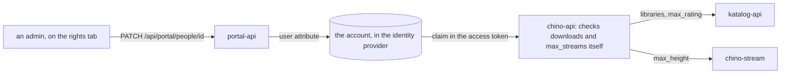

# People and what they may do

This page specifies how a household's people are kept and what each of them
may do. It covers the portal's people console, where an admin adds a person,
sets what they may see and play, and sees who is watching now; the code that
guards an account on a device several people share; where a person looks after
their own password, second factor and sign-ins; and what the servers do for
all of it: the identity provider's realm, portal-api, chino-api, chino-stream
and the catalog. The reasons are in
[ADR-0018](../../docs/adr/0018-people-rights-and-safety.md). What chino's apps
show of it is specified in chino's chapters [3](../chino/start.md),
[16](../chino/settings.md) and [17](../chino/errors.md), in the changes this
page names.

The section As built describes what the platform does today. The sections
after it are the target, and the section Changes lists every difference
between the two as a numbered change. Only a change the owner has approved is
built, one change at a time; anything no change names stays as it is built.

## Purpose

A household is several people, and they are not alike: a parent runs the
server, a child may see only some of the library, a guest watches for a
weekend. This page is for the admins, who add people and say what each may
do; for every person, who keeps their own password and, on a shared TV, their
own code; and for parents, who have to be able to rely on a child's limits.

It serves the goal
[Share it with a household](../goals/README.md#share-it-with-a-household) and
its two qualities: a child sees only what it may, and someone who forgot a
password is back in soon. Of
[what people expect](../capabilities/expectations.md#share-it-with-a-household)
it covers rights for each person, a lock on a shared TV, a forgotten password,
a second factor, one's own devices, a limit of streams, and who is watching
now.

Three things are left out. What was watched over time comes after the page of
who is watching now. Bringing people from another media server is an addon's.
The command line's commands for people come later. How the platform sends
mail is decided in [ADR-0019](../../docs/adr/0019-mail-and-alerts.md) and set
out in [Running the platform](./operations.md#mail); this page says what a
person gets once mail is set up, and what happens without it.

## As built

This section says what the platform does as of 22 November 2026, as the code
of `zaentrum-portal`, `zaentrum-operator`, `chino-api`, `chino-stream`,
`katalog-api`, `katalog-manager` and the four chino apps has it at their main
branches.

### Accounts and the People page

There is one account per person, kept in the identity provider. With the
bundled one, Keycloak 26.0.7 and its realm `zaentrum`, portal-api manages the
accounts through a client of its own, `zaentrum-people`, whose service account
may view, query and manage the realm's users and nothing else.

An account has a username (3 to 64 characters: letters a to z, digits, and
`.`, `_` and `-` between them; it never changes), a name of up to 100
characters, a role and a switch. The role is admin or user: everyone holds the
realm role `zaentrum-user`, and an admin `zaentrum-admin` as well. An account
can hold an email address; the page shows it and cannot set it, while
portal-api's routes can.

The People page, `/portal/people`, is for admins. It is headed “People”, over
“One account per person: their role, a child's rating cap, their invite
link.” It has **Add Person** and one table: Name, Username, Role, Rating Cap,
Status and Invite, with four icon buttons in each row: Edit, New Invite Link,
Disable or Enable, and Delete. On a phone each person is a card with the same
facts and buttons. Add and Edit open a dialog with Name, Username, Role and
Rating Cap. Every change asks first, in a dialog that lists what will happen.
There is no page for one person, no search and no filter.

| Route of portal-api | What it does |
|---|---|
| `GET /api/portal/people` | everyone, at most 2,000 accounts, by name, each with the state of their newest invite; and the mode: `bundled`, `external` or `unavailable` |
| `POST /api/portal/people` | adds a person, enabled and without a password, from `username`, `displayName`, `email`, `role` and `maxRating`; answers their first invite link, mailed to their address with `sendInvite` |
| `PATCH /api/portal/people/{id}` | changes `displayName`, `email` (empty removes the address), `role`, `maxRating` (null removes the cap) and `enabled` |
| `DELETE /api/portal/people/{id}` | deletes what chino-api keeps of the person, then the account, then their invites and notices |
| `POST /api/portal/people/{id}/invite` | a new invite link, mailed to their address with `send`; the older ones stop working |
| `GET` and `POST /api/portal/invites/{token}` | without a sign-in: whose invite it is, and setting the password, once |

portal-api keeps four rules. The last enabled admin stays an admin and stays
switched on. Nobody changes their own role, switches themselves off or deletes
themselves here. An account that administers Keycloak itself, such as the
first admin, is changed in Keycloak's admin console alone. The platform's own
test account is not listed.

With an outside identity provider (`identity.mode: external`) the page says
“People sign in with your identity provider: add them, change them and give
them their roles there.”, with the link **Open Identity Provider**, and
portal-api refuses every change.

### Invites, and a forgotten password

An invite link is `/portal/invite/` followed by a token of 32 random bytes.
portal-api keeps the token's SHA-256, never the token. A link holds for 7 days
(`PORTAL_INVITE_TTL`), works once, and is shown once, in a dialog with **Copy
Invite Link**. The admin hands it over by hand: the page asks for no address
and cannot send the link, though portal-api's routes mail it when asked
([mail](./operations.md#people-and-addresses)).
The person opens it without signing in and chooses a password under the
realm's policy: at least 8 characters, not the username, not the email
address. A new link stops the older ones, and switching an account off revokes
its open link.

A new invite link is also how a forgotten password is replaced today: it sets
a new password and clears a lockout from failed sign-ins. It is refused for
the admin's own account, for an account that is switched off and for one that
administers Keycloak.

The sign-in page shows “Forgot password?” only where mail is set up in the
platform's resource: the realm is made with the password reset off, and the
realm job switches it on with mail. The link goes to the account's address,
and an account without one gets none. Without mail the page says “Forgot your
password? Ask an admin for a new invite link.” The documentation still sends
an admin to Keycloak's admin console for password resets and second factors,
and that console is not on the public host.

### The rating cap, the one right

A person has a role and, at most, a rating cap: nothing finer. The cap travels
in four steps.

1. **On the account.** The user attribute `max_rating`, an age from 0 to 21.
   The realm's user profile declares it so that only an admin sees or changes
   it. Keycloak keeps no attribute its profile does not declare, so portal-api
   reads every cap back after it wrote it. An admin has none: portal-api
   refuses a cap on an admin.
2. **In the token.** A mapper named `max-rating` puts the attribute into the
   access token as the whole-number claim `max_rating`, on each client whose
   tokens chino-api takes: `zaentrum-web`, `chino-web`, `chino-tv`,
   `chino-mobile` and `zae`. The realm's job, which runs after every install
   and upgrade that changes what it sets, keeps the attribute and the mappers
   so, and gives a client the audience chino-api takes only after its mapper
   for the cap.
3. **In chino-api.** A token without the claim is not capped. A claim that is
   no whole number of years caps at 0, the strictest. chino-api passes the cap
   to katalog-api as `max_rating` on every catalog request. Before it serves
   or proxies anything of one title, its stream, a picture or a subtitle, it
   asks katalog-api's `GET /api/v1/visible`, and keeps each answer for 30
   seconds.
4. **In the catalog.** katalog-api leaves out every title rated above the cap,
   and every unrated one unless the catalog's setting
   `ratings.unrated_for_capped` says show. It takes the stricter of the
   token's claim and the parameter. katalog-manager holds its picture,
   playback and subtitle routes to the cap in the same way. A title above the
   cap answers as one that is not there, with 404, so nothing says that it
   exists.

**The stream pass.** A player cannot put a bearer on the address of a stream
or a picture. It asks `POST /api/v1/me/stream-token` for a pass, a signed
token that names the person and their cap and lasts 6 hours, and puts it on
those addresses as `?stream=`. chino-stream checks the pass's signature and
its expiry and reads nothing else from it.

**How long a change takes.** An access token of the bundled realm lasts 5
minutes (`accessTokenLifespan`, 300 seconds), so lists and title pages follow
a new cap within 5 minutes, and the People page says so. A pass made before
the change keeps the old cap on streams and pictures until it runs out, 6
hours at most.

**With an outside identity provider** the admin provides the claim
`max_rating` there, as [the prerequisites](../../docs/prerequisites.md#identity)
say.

**Nothing finer.** The catalog keeps one set of titles, with no libraries to
tell apart. Downloads are one switch for the whole server
(`DOWNLOADS_ENABLED`, told to the apps as `features.downloads`), and the
switch changes nothing on the server: a download is fetched from the playback
routes, as a stream is. Nothing limits a person's quality or the number of
their streams.

### Several accounts on one device

The phone app, Android TV and the Samsung TV keep a list of accounts on the
device, each with its tokens, and one of them is the active one. Choosing
another makes it the active one at once: no app asks for anything, and no
server is asked. The web keeps one account in a browser and has no chooser.
This is the one way around a rating cap that the goals name.

Two apps carry a pass over from one person to the next. Android TV keeps one
pass for as long as the app runs and drops it only when an account is deleted,
so after a switch the next person's streams and pictures are served under the
pass, and the cap, of the person before, for up to 6 hours. The web keeps the
pass with the browser tab and does not drop it at a sign-out. The phone app
drops it at every switch, and the Samsung TV asks for a new one with every
screen.

No app knows whether an account is capped: `GET /api/v1/me` answers the
account's id alone, and no app reads the claim.

### Passwords, second factors and sign-ins

| What | Today |
|---|---|
| Changing one's password | Nowhere in the platform's own pages. The identity provider's account pages, `/auth/realms/zaentrum/account/`, are on the public host, because the chart's Ingress and Routes send Keycloak `/auth/realms` and `/auth/resources`; nothing in the portal or in an app links there. The People page tells an admin who asks for an invite for themselves “You are signed in already: change your own password in your account settings.”, and neither the portal nor chino has such settings |
| A second factor | Nothing in the platform offers one or asks for one |
| One's sign-ins | Nothing in the platform lists them; signing out is done on the device. Keycloak ends a browser's sign-in 30 minutes after its last use and 10 hours after it began, and offers “Remember me”. The phone and TV apps ask for a sign-in that outlives the browser's, which the realm keeps while it is used at least every 30 days. Switching an account off ends its sign-ins within 5 minutes |
| Failed sign-ins | The realm's protection against guessing is on |

### What the server knows of a stream

No server keeps a session for a stream. chino-api proxies every playlist and
segment to chino-stream and keeps nothing of it. It saves a person's position
in a title, which the players send about every 10 seconds while they play. It
logs the playback events the players send, and counts startup times and stalls
from them; it writes none to its database. The phone app and Android TV name
their device's model in those events and in a bug report, and nowhere else;
the Samsung TV sends no events; no app keeps an id of its own installation.
No page shows who is watching, and nothing can stop a stream but the person
watching it.

## The person's page

The people console is one app of the portal, at `/portal/people`, for admins,
with two views in its own navigation, as the design system's
[app navigation](https://nalet.github.io/design-system/patterns/app-navigation/)
has it: **people**, and **watching now** (section Who is watching).

**people** is a [worklist](https://nalet.github.io/design-system/patterns/worklist/).
Its filter bar holds a search over name, username and email address, and two
selects, **role** and **status**. Its table has one row a person, sorted by
name:

| Column | Shows |
|---|---|
| **name** | the person's name, the row's name; under it, quieter, the email address where the account has one; the badge “you” on the admin's own row |
| **username** | what the person signs in with, in the monospace face |
| **role** | “admin” or “user”, a badge; beside it the badge “identity provider” on an account that administers the identity provider itself |
| **limits** | “none”, or what the rights tab limits, in this order, joined by “·”: “2 libraries”, “up to 12”, “no downloads”, “High (1080p)”, “2 streams” |
| **status** | “enabled” or “disabled”, the design system's status |
| **invite** | what became of the newest invite link, as today: “invited”, “joined”, “link expired”, “link revoked”, or a dash |

A row opens the person's page. The rows have no buttons of their own. On a
phone each person is a card with the same facts, as today, and the card opens
the page. **add person**, the emphasized button above the table, opens a
dialog with **Name**, **Username**, **Role** and **Rating cap**, and
**cancel** and **add person**. A cap is asked for here, so that a child's
account is capped before its invite link exists. Adding a person opens their
page, with the invite link in its dialog over it.

The person's page is a detail page with tabs, at `/portal/people/` and the
account's id. Its heading is the person's name; under it stand the username,
the role and the status. Its actions are **new invite link**, **switch off**
or **switch on**, and **delete**, the danger button.

Every change asks first, as today, in the design system's dialog. The
question's title is the action and the person, in lowercase, “switch Mia
off?”; its lines are the ones the page has today, each written as a sentence;
and its confirming button names the action, the danger button for switch off
and delete.

| Tab | Holds |
|---|---|
| **account** | a form: **Name**; **Username**, shown and not changed; **Role**, a select of user and admin; **save** |
| **rights** | a form with the five rights of the section Rights, and **save** |
| **security** | **account lock**, **second factor** and **password**, as the sections Account lock, Sign-in and security and Forgotten passwords set them out |

- **save** is the emphasized button, and stays off until the form differs from
  what is kept. Saving asks first, as today, with one line for each value
  that changes (section Words), and then says so in a toast.
- The rules of today hold: the last enabled admin stays one, nobody changes
  their own role or switches themselves off, and an account that administers
  the identity provider is shown and not changed, under a banner that says
  where it is changed.
- **An email address** is a field of the add person dialog and of the
  account tab once [Running the platform](./operations.md#people-and-addresses)
  adds it (R.C4), with the switch that sends an invite link by mail. A person
  may also set their own address on the identity provider's page (section
  Sign-in and security).
- With an outside identity provider the view **people** has no table. It says
  that people live there, links there, and lists the claims the admin maps
  there to limit a person (section Rights). The view **watching now** works as
  with the bundled one.

portal-api offers the page what it offers today, and more:

| Route of portal-api | What it does |
|---|---|
| `GET /api/portal/people` | each person also carries `libraries`, `downloads`, `maxHeight` and `maxStreams`, beside `maxRating`; and the answer carries `libraries`, the catalog's libraries with id, name and kind, which portal-api asks of the catalog with the admin's own sign-in: an empty list while the catalog has none |
| `GET /api/portal/people/{id}` | one person, as the list has them, with `security`: `lock` (`set`, `setAt`) and `secondFactor` (`set`, `kinds`) |
| `PATCH /api/portal/people/{id}` | also takes `libraries` (a list of library ids, or null for every library), `downloads` (true or false), `maxHeight` (480, 720, 1080 or 2160, or null) and `maxStreams` (1 to 10, or null) |
| `DELETE /api/portal/people/{id}/lock` | clears the person's code (section Account lock) |
| `DELETE /api/portal/people/{id}/second-factor` | removes every second factor of the account at the identity provider (section Sign-in and security) |

A right on an admin is refused with 400, as a cap is today: a right is for a
user. Choosing the role admin in the form empties the rights. A library id
the catalog does not name is refused with 400. After each write portal-api
reads the values back, as it does for the cap, and refuses with 502 when the
identity provider did not keep one.

## Rights

A right is a value on the person's account that travels in the person's access
token, as the rating cap does today. Every service reads it from the token and
asks no other service what a person may do.



### The five rights

| Right | Attribute and claim | Values | Without it | Who enforces it | What a refused person is told |
|---|---|---|---|---|---|
| Libraries | `libraries` | a list of library ids, as [the catalog gives them](../catalog/library.md#libraries), such as `kids-movies`; at least one | every library, and each one added later | katalog-api, on every list and every title; chino-api asks it before it serves a stream, a picture or a subtitle; katalog-manager on its own picture and playback routes | nothing: a title of another library is as one that is not there, left out of every list, and its page reads “this title isn't in the library anymore” |
| Rating cap | `max_rating` | an age from 0 to 21 | no cap | as built | as built: the same as for a library |
| Downloads | `downloads` | `false`, which switches them off | downloads are allowed | chino-api: it tells the app, and it opens no play session of the kind download (section Who is watching) | the title's page offers no download; one under way stops with “Downloads are switched off for this account.” |
| Highest quality | `max_height` | 480, 720, 1080 or 2160 | no limit | chino-api puts it on every play request it proxies; chino-stream serves nothing taller | the player's quality menu lists what the account may play, over “This account plays up to High (1080p).” |
| Streams at once | `max_streams` | a whole number from 1 to 10 | no limit | chino-api, when a play session opens | the player lists the devices that are playing and offers to stop one (section Streams at once) |

- **Who sets them.** An admin, on the rights tab of the person's page. A
  person changes none; the apps say what limits them where it matters
  (change 17.C16).
- **An admin has none.** portal-api writes no right on an account with the
  admin role. A service enforces whatever a token carries, so with an outside
  identity provider an admin's token may carry one.
- **A claim gone wrong shows less, never more**, as the cap does today. A
  `libraries` that is no list of strings lets no library through; a
  `max_rating` that is no whole number caps at 0; a `downloads` that is
  neither true nor false refuses downloads; a `max_height` that is none of the
  four values counts as 480; a `max_streams` that is no whole number from 1 up
  counts as 1.
- **A height is the height a quality is named by**
  ([chapter 11](../chino/playback.md), section 11.9): a scope film of
  1920 × 818 counts as 1080.

### On the account and in the token

The realm's user profile declares each attribute as it declares `max_rating`:
seen and changed by an admin alone, so a person cannot change their own on the
identity provider's page.

| Attribute | In the user profile | The mapper, on each client whose tokens chino-api takes | The claim |
|---|---|---|---|
| `libraries` | several values, each a library id: 1 to 32 lowercase letters, digits and hyphens | `libraries`, several values | a list of strings |
| `max_rating` | as built: a whole number from 0 to 21 | as built: `max-rating` | a whole number |
| `downloads` | one value, `false` | `downloads` | false |
| `max_height` | one value of `480`, `720`, `1080`, `2160` | `max-height` | a whole number |
| `max_streams` | a whole number from 1 to 10 | `max-streams` | a whole number |

The realm's job keeps the four new attributes and mappers as it keeps the
cap's: declared as above, on the same five clients, and before the audience
that makes a client's tokens ones chino-api takes. A realm made before this
change gets them at the next upgrade. ADR-0018 asks for a short trial of the
list and of the value false before P.C1 is built.

With an outside identity provider the admin maps the same five claims there,
with the same names and types, for the people to be limited. The people view
lists them, and [the prerequisites](../../docs/prerequisites.md#identity) do.

### What chino-api does with them

chino-api reads the five claims from every bearer, as it reads `max_rating`
today, and says what it read:

`GET /api/v1/me` answers the account's id and name, its rights and whether it
has a code:

```json
{
  "sub": "5f0c…",
  "name": "Mia",
  "rights": {
    "libraries": ["kids", "shows"],
    "maxRating": 12,
    "downloads": false,
    "maxHeight": 1080,
    "maxStreams": 2
  },
  "lock": { "set": false }
}
```

A right the token does not carry is null, and `downloads` is true. The apps
read the rights here and never from a token.

**Libraries.** chino-api passes the list to katalog-api on every catalog
request, as `libraries`, the ids joined by commas, beside `max_rating`.
katalog-api serves a title only when its library is in the list, and takes the
list of the token's claim and of the parameter together: a library has to be
in both. `GET /api/v1/visible` takes `max_rating`, `libraries` or both, and
answers 400 with neither. chino-api's check before a stream, a picture or a
subtitle, which today runs for a capped person, runs for a person with a list
as well. katalog-manager holds its picture, playback and subtitle routes to
the list as it holds them to the cap. The routes that refuse a capped token
today, the library's holdings, refuse a token with a list.

Which libraries a person sees is kept in one place, on the accounts. The
catalog keeps no list of a library's people
([the library](../catalog/library.md#who-sees-a-library)): a library's
audience is everyone, until a person's right leaves it out. A screen that
shows who sees a library reads it from portal-api's list of people, and the
rights tab is where it is changed.

**Highest quality.** chino-api adds `max_height` to every play request it
proxies to chino-stream for a person with the right, as their bearer or their
pass says it, and takes out one a client sent. chino-stream then treats the
client as one that decodes nothing taller, as it treats a height in the
client's `caps` today: the master playlist and `/info` leave out every
rendition that is taller, a `q` that names one plays the ladder instead, and a
playlist or a segment of one answers 403. A title whose package holds nothing
at or under the height plays from the renditions chino-stream makes as it
plays.

**Downloads** and **streams at once** are checked when a play session opens
(sections Who is watching and Streams at once).

**The stream pass** names the person and carries their rights, as chino-api
read them from the bearer that asked for the pass, because a request for a
stream or a picture carries no bearer. Its user part is the account's id and
then a mark for each right the person has, in this order:

| Mark | For a person |
|---|---|
| `;play=session` | whose streams are limited or whose downloads are switched off: the play routes refuse such a pass, and such a person's bearer, with 403 `session_needed`, and serve them only for a session's pass (section Who is watching); pictures, subtitles and events take the pass as before |
| `;libraries=` and the ids joined by commas | with a list of libraries |
| `;max_height=` and the height | with a highest quality |
| `;max_rating=` and the age | with a cap, as built |

The cap's mark stays last: the services built today read the cap after the
last mark, and take the rest of the user part for the account's id.

### When a change takes effect

A change applies when the person's access token is next renewed. With the
bundled identity provider that is 5 minutes at most, the lifetime the realm
gives an access token; with an outside one, the lifetime it gives.

- Lists, title pages and the opening of a play session follow the new token.
- A title that is playing plays on under the rights it started with. An admin
  who wants it to end stops it (section Who is watching).
- A pass made before the change still shows pictures and subtitles under the
  old rights until it runs out, 6 hours at most; once play sessions are
  required (P.C12) it plays nothing.
- The rights tab says how long, from the lifetime of the admin's own access
  token, rounded up to whole minutes.

## Account lock

A person may guard their account with a code of 4 to 8 digits. Where several
accounts are signed in on one device, choosing an account that has a code asks
for it. The code is the account's: one code, on every device.

### What chino-api keeps and checks

chino-api keeps the code in its own database as a salted hash (bcrypt, cost
10), by the account's id, with the day it was set. It never answers the code
or the hash. It deletes them with the account.

| Route of chino-api | For | What it does |
|---|---|---|
| `PUT /api/v1/me/lock` | the person, with their own bearer | sets, changes or removes the code: `{"code": "482913", "current": "1234", "device": "…"}`. `code` is 4 to 8 digits, or null to remove it. `current` is needed while a code is set, unless the person signed in afresh (below). Answers 204 |
| `POST /api/v1/me/lock/check` | an app, with the bearer of the account being chosen | checks `{"code": "1234", "device": "…"}`. Answers 204 when it is right, and 409 `no_code` when the account has none |
| `GET /api/v1/admin/accounts/{sub}/lock` | an admin | `{"set": true, "setAt": "2026-11-03T18:42:00Z"}` |
| `DELETE /api/v1/admin/accounts/{sub}/lock` | an admin | clears the code; 204, also when there was none |

- **Wrong tries.** A wrong `code` to the check, and a wrong `current`, answer
  403 `wrong_code` with `triesLeft`. chino-api counts them by account and
  device. After 5 wrong tries it answers 429 `locked` with `retryAfterSeconds`
  and a `Retry-After` header for 15 minutes, whatever is sent; then the
  count starts again. A right code sets the count to nothing.
- **The device** is the app's installation id: 16 random bytes in hex, which
  an app makes at its first start and keeps with its own data.
- **A code that is no code**, anything but 4 to 8 digits, answers 400
  `code_form`.
- **A fresh sign-in stands in for the code.** A bearer whose sign-in, its
  `auth_time`, is at most 5 minutes old may set or remove the code without
  `current`. So a person who forgot the code signs in again with their
  password and chooses a new one. ADR-0018 asks for a trial of this before
  16.C21 offers it.
- **Without a database** chino-api answers these routes 503, and
  `lock.set` is false.

### In the apps

The apps' screens are chino's: change 3.C16 for the code asked when an account
is chosen, 3.C17 for the request to set one, and 16.C21 for setting, changing
and removing it. Their rules:

- **When it is asked.** On the phone app, Android TV and the Samsung TV,
  wherever an account is chosen while the device holds two accounts or more:
  on who's watching, and on a switch from settings. The app asks
  `GET /api/v1/me` as each account to learn whether it has a code, and keeps
  the answer with the account for when the server cannot be reached.
- **Who checks.** The server, through the route above, with the bearer of the
  account being chosen. The app makes the account the active one only after
  204.
- **Without the server** an account with a code cannot be chosen: the app says
  that the server checks the code and cannot be reached. The account that was
  open stays open.
- **Back after a while.** Where an account on the device has a code, the app
  opens on who's watching whenever it starts, and whenever it comes back to
  the front after 15 minutes or more away, so that an account left open does
  not stay open.
- **The one-time request.** When a device holds an account with a rating cap
  and the account being opened has no cap and no code, the app asks its person
  once, on that device, to set a code.
- **The web** keeps one account in a browser and has no chooser, so it asks
  for no code. Its account page sets, changes and removes the code like the
  apps'.
- **A device with one account** asks for no code.

### An admin clears a code

The security tab of the person's page shows **account lock**: “A code is set,
since 3 Nov 2026.” or “No code is set.”, and **clear code**, the danger
button, while one is set. It asks first, and then calls
`DELETE /api/portal/people/{id}/lock`, which portal-api passes to chino-api
with the admin's own bearer. The person then sets a new code in their app. An
admin sees that a code is set, never the code.

With an outside identity provider the portal lists no people, so there an
admin has no page to clear a code on; the fresh sign-in above is the way.

### What the code does not do

The code keeps a person out of another account in the apps. It does not
protect the sign-ins a device holds from someone who takes the device apart,
and it does not sign anyone out.

## Sign-in and security

Passwords, second factors and sign-ins are the identity provider's own. The
platform builds no page for them: it links to the identity provider's account
page, in one entry named **sign-in and security**.

| Where | The entry |
|---|---|
| The portal | in the avatar's user menu ([home page](./home.md), H.C2), between settings and sign out; it opens the page in a new tab |
| chino on the web | on the account page (change 16.C22); a new tab |
| The phone app | on the account page, while the phone holds one account; it opens the page in the phone's browser. With several accounts on the phone the entry is not shown, because the browser's sign-in may be another person's |
| Android TV, Samsung TV | none: a TV has no browser |

**The address.** With the bundled identity provider it is the issuer followed
by `/account/`, so `https://media.example.org/auth/realms/zaentrum/account/`.
With an outside one it is `spec.identity.accountUrl` of the platform's
resource, and without that field the entry is not shown anywhere. The chart
gives the address to chino-api as `ACCOUNT_URL`, and chino-api tells the apps
and the portal in `GET /api/config`, as `accountUrl`; it leaves the field out
when there is none.

**What the page offers** with the bundled identity provider, in Keycloak's own
look and words:

| On the page | A person can |
|---|---|
| Personal info | change their name and their email address; not their username, and not their rights, which the page does not show |
| Account security, Signing in | change their password; set up an authenticator app as a second factor, which the sign-in then asks for after the password |
| Account security, Device activity | see the devices signed in to their account, and sign one out |

This is what the identity provider's own guide describes for the version the
platform ships. ADR-0018 asks that it be seen on a running installation before
P.C15 and 16.C22 are built, with what the list of devices shows of a TV or a
phone, whose sign-in outlives a browser's.

**A lost second factor.** The security tab of the person's page shows
**second factor**: “On: an authenticator app.” or “Off.”, and **remove second
factor**, the danger button, while one is set. It asks first, and then calls
`DELETE /api/portal/people/{id}/second-factor`. The person then signs in with
the password alone and may add a second factor again. A new invite link does
not remove a second factor.

## Forgotten passwords

Mail is the platform's to send once an admin sets it up; how, and every word
of a mail, is in [Running the platform](./operations.md#mail). What it means
for someone who forgot their password:

| The server | Someone who forgot their password |
|---|---|
| sends mail, and the account has an email address | presses “Forgot password?” on the sign-in page and gets the identity provider's mail with a link, which works for 5 minutes, to choose a new password |
| sends mail, and the account has no address | asks an admin, who makes a new invite link, or adds the address first |
| sends no mail | reads “Forgot your password? Ask an admin for a new invite link.” on the sign-in page, and asks an admin |

- **“Forgot password?” is shown only where it works.** The realm's job
  switches the realm's password reset on with mail and off without it
  ([the sign-in page](./operations.md#the-sign-in-page), R.C5). With an
  outside identity provider the sign-in page is that provider's.
- **A new invite link** is made on the person's page, by **new invite link**
  in its actions and under **password** on the security tab. It does what it
  does today: the person chooses a new password with it, and their old one
  works until they do. Where mail is ready and the account has an address, the
  link's dialog offers to send it
  ([people and addresses](./operations.md#people-and-addresses), R.C4);
  otherwise the admin hands it over, as today.
- **The admin's own password.** An admin changes it under sign-in and
  security; the sentence the page says today then leads somewhere.

## Who is watching

### A play session

chino-api keeps a play session for every stream: who plays what, on which
device, at which quality, since when. It keeps none today. A session is one
player on one device, from the moment it opens until it closes. The player
opens the session before it asks for a stream, sends a beat while it is open,
and closes the session when it leaves.

| Route of chino-api | What it does |
|---|---|
| `POST /api/v1/play/sessions` | opens a session for the bearer's account. It takes `{"kind": "play", "itemId": "…", "extraId": null, "device": {"id": "…", "name": "Living Room TV", "kind": "tv"}, "client": "chino-androidtv 1.4.0"}` and answers 201 with `{"id": "…", "stream": "…", "expiresAt": "…", "beatSeconds": 30, "maxHeight": 1080}` |
| `POST /api/v1/play/sessions/{id}/beat` | says the session is alive, and what it plays: `{"state": "playing", "itemId": "…", "extraId": null, "positionSec": 1312, "height": 1080}`. Answers 204, or 410 `session_ended` with `by` (`admin`, `self` or `timeout`) and, for an admin, `name` |
| `DELETE /api/v1/play/sessions/{id}` | ends a session of the bearer's own account: the player's own as it leaves, or another one of the same person (section Streams at once). 204 |

- **Kinds.** `play` is a player with a title or one of its extras. `zap` is
  one visit to zap. `download` is a phone taking titles along.
- **The title.** The player names it at the opening, and again in its next
  beat when it goes on to another: the next episode, the next card of zap. The
  session stays the same.
- **The device.** `id` is the app's installation id (section Account lock).
  `name` is what the device calls itself: the name its owner gave it, else its
  model; in a browser, the browser and the system, “Firefox on Linux”. `kind`
  is `tv`, `phone`, `tablet` or `computer`.
- **A cast** is a stream of the person who cast it, on the screen it plays on.
  The phone opens the session for a screen that plays the stream by itself,
  with the phone's id followed by `/cast`, the screen's name and the kind
  `tv`. A TV app that plays a cast as its sender
  ([ADR-0022](../../docs/adr/0022-casting-starts-the-tv-app.md)) opens the
  session itself, as the sender.
- **What is checked at the opening, in this order.** The title is one the
  person may see, else 404. For a download, the right allows it, else 403
  `downloads_off`. For `play` and `zap`, the person is under their limit of
  streams, else 409 `too_many_streams` (section Streams at once).
- **The session's pass.** `stream` is a stream pass with the session's id in
  it: `;sid=` and the id, straight after the account's id. chino-api serves a
  play request that carries it only while the session is alive, and holds it
  to the person's rights as it holds every pass. For a session that ended it
  answers 410. The pass runs out with the session, 6 hours after it
  opened at the latest; a player still open then opens a new session.
- **Alive.** A session is alive from its opening until it is closed or
  stopped, or until 90 seconds pass without a beat. A player sends a beat
  every 30 seconds while it is open, playing or paused. A `download` sends no
  beat: its session is alive until the phone closes it, 6 hours at the
  latest.
- **One a device.** Opening a session ends the one the same person had on the
  same device, without counting it: a player started again after it was
  closed without a word.
- **What is kept.** For each session: its id, the account's id and name as
  the bearer gave them, the kind, the device, the app, the highest quality it
  started with, when it began, its last beat with title, state, position and
  height, and when, by whom and how it ended. A session that ended is kept for
  24 hours, so that its player can be told why it ended, and then deleted.
  Nothing over time is kept. The sessions go with the account when it is
  deleted.

### The page watching now

**watching now** is the people console's second view, at
`/portal/people/watching`. It is a table of the streams that are alive, of the
kinds `play` and `zap`, newest first, and it asks again every 10 seconds.

| Column | Shows |
|---|---|
| **person** | the account's name |
| **title** | a movie with its year, “Sintel (2010)”; an episode with its show and code, “Pioneer One · S01E01 · Earthfall”; an extra with its title, “Sintel · trailer”; “zap” |
| **device** | its kind and name, “TV · Living Room TV” |
| **quality** | the name of the quality playing, “High (1080p)”, as chapter 11 names it; “paused” beside it while the player is paused |
| **since** | when it began and for how long, “18:42 · 35 min” |
| | **stop**, a quiet button |

**stop** asks first, in the design system's dialog: whose stream of what on
which device stops. Then the session is ended, with the admin's name. The
person's player stops at its next beat, 30 seconds at most, or sooner when it
asks for its next segment, and says who stopped it (change 17.C16). Stopping
ends that stream. It takes nothing from the person: they can start a title
again, unless their account is switched off or their rights changed.

| Route | What it does |
|---|---|
| `GET /api/v1/admin/play/sessions` of chino-api | for an admin: the sessions that are alive, each with `id`, `sub`, `name`, `kind`, `title` (its name, year, kind and, for an episode, show and code), `device`, `client`, `state`, `height`, `quality` (the name), `startedAt`; and `required`, whether a stream needs a session (P.C12) |
| `DELETE /api/v1/admin/play/sessions/{id}` of chino-api | for an admin: ends the session, with `by` admin and the admin's name |
| `GET /api/portal/streams`, `DELETE /api/portal/streams/{id}` of portal-api | what the page calls: portal-api passes them to chino-api with the admin's own bearer |

While a stream does not yet need a session, a banner above the table says that
an app that has not been updated plays without showing here.

## Streams at once

The limit of streams at once is checked when a play session opens, never while
a title plays.

- chino-api counts the person's sessions that are alive, of the kinds `play`
  and `zap`, on other devices. A paused one counts: its player is open.
- When the count has reached `max_streams`, the opening is refused with 409
  and the streams that count:

  ```json
  {
    "error": "too_many_streams",
    "maxStreams": 2,
    "sessions": [
      {
        "id": "…",
        "device": { "name": "Living Room TV", "kind": "tv" },
        "title": "Sintel (2010)",
        "state": "paused",
        "startedAt": "2026-11-15T18:42:00Z"
      }
    ]
  }
  ```

- The player lists those streams, by device, title and time, and offers
  **stop** on each (change 17.C16). **stop** calls
  `DELETE /api/v1/play/sessions/{id}`, and the player then opens its own
  session again and plays. The stopped device's player says that the stream
  was stopped from another device.
- A stream that ended without saying so, because its app was closed or its
  device lost the network, stops counting 90 seconds after its last beat.
- A download is never counted.
- From P.C8 on, chino-api serves the play routes to a person with the right
  only for a session's pass: the pass an app gets without a session is marked
  `;play=session` (section What chino-api does with them). So an app that
  opens no session cannot go around the limit: it plays nothing for that
  person.

## Changes

Every difference between the section As built and the target is one change in
the table. A change names where it is built, what is there today and the
target, with the section that sets it out; it is built as its row says, and
nothing else changes with it. Each change starts as proposed. A target that
starts with “Recommended” holds a choice that is the owner's. The changes in
chino's chapters that belong to this page are 3.C16 and 3.C17
([chapter 3](../chino/start.md)), 16.C21 and 16.C22
([chapter 16](../chino/settings.md)) and 17.C16
([chapter 17](../chino/errors.md)).

| No. | Change | Where | Today | Target | Status |
|---|---|---|---|---|---|
| P.C1 | The rights as values on the account and claims in the token | Operator, Docs | the realm's user profile declares one attribute of the platform's, `max_rating`, and the realm's job keeps one mapper for it, `max-rating`, on five clients; the prerequisites name one claim for an outside identity provider | the section On the account and in the token: the attributes `libraries`, `downloads`, `max_height` and `max_streams` declared for admins alone, and their mappers on the same five clients, kept by the realm's job before the audience, in new realms and at the next upgrade of an old one; the prerequisites name the five claims and their types; the realm's job also puts the time of the sign-in, `auth_time`, into the tokens of the five clients (the client scope `basic`, which the imported realm lacks, or a mapper of the session's own), as a fresh sign-in in place of an account's code needs it (P.C13) | approved |
| P.C2 | A person's rights through portal-api | Server | portal-api reads and writes a name, a role, a switch and `maxRating`; there is no route for one person | portal-api, the section The person's page: `libraries`, `downloads`, `maxHeight` and `maxStreams` in the list and in `PATCH`; `GET /api/portal/people/{id}`; a right on an admin refused with 400; a library id the catalog does not name refused with 400; every value read back after it is written | approved |
| P.C3 | The people worklist and the person's page | Portal | one page: a table with four icon buttons in each row, and a dialog with Name, Username, Role and Rating Cap; no page for one person, no search, no filter; labels in capitals, “Add Person”, “Rating Cap” | the section The person's page: the views people and watching now in the console's own navigation; people a worklist with a filter bar and the columns name, username, role, limits, status and invite; a row opens the person's page, a detail page with the tabs account, rights and security, the actions new invite link, switch off or on and delete; the words of the section Words, labels in lowercase; with an outside identity provider the claims to map | approved |
| P.C4 | chino-api reads the rights and says them | Server | chino-api reads `max_rating` from a bearer and nothing else of a person's; `GET /api/v1/me` answers the account's id alone; the stream pass carries the id and the cap | chino-api, the section What chino-api does with them: the five claims read from every bearer, a claim gone wrong counted as the strictest value; `GET /api/v1/me` with `name`, `rights` and `lock`; the stream pass with a mark for each right, the cap's last | approved |
| P.C5 | A person sees their libraries only | Server | the catalog keeps one set of titles, and nothing holds a person to a part of it | once the catalog keeps libraries ([the library](../catalog/library.md), L.C1): katalog-api, katalog-manager and chino-api hold a person to the list in their token, as the section What chino-api does with them sets out: the claim `libraries`, the parameter `libraries` on every catalog request and on `GET /api/v1/visible`, the stream pass's list, a title of another library answered as one that is not there, in every list, count and route that is held to the rating cap today | approved |
| P.C6 | The highest quality | Server | chino-stream leaves out what a client's `caps` say it cannot decode; nothing limits a person | chino-api and chino-stream, the section What chino-api does with them: `max_height` put on every play request chino-api proxies for a person with the right, a client's own taken out; chino-stream serves no rendition that is taller, in the master, in `/info` and by its own address | approved |
| P.C7 | Play sessions | Server | no server keeps a session for a stream: chino-api proxies the play routes, saves positions and logs playback events | chino-api, the section A play session: the three routes, the kinds play, zap and download, the checks at the opening, the session's pass, alive for 90 seconds after a beat, one a device, what is kept and for how long; a download refused for a person whose downloads are switched off, whose pass is marked `;play=session`; any other play request without a session is served as today | approved |
| P.C8 | Streams at once | Server | nothing counts a person's streams | chino-api, the section Streams at once: the opening of a session refused with 409 `too_many_streams` and the list of the person's streams once `max_streams` is reached; a person's own session ended from another device; the pass of a person with the right marked `;play=session`, so that the play routes serve them only for a session's pass | approved |
| P.C9 | The players open a play session | Web, Phone app, Android TV, Samsung TV | a player asks for a stream with the account's stream pass; no app keeps an installation id or names its device to the server, and the Samsung TV sends no playback events | every player, zap and the phone's downloads open a session before they ask for a stream, with the app's installation id and the device's name and kind, play with the session's pass, send a beat every 30 seconds, which names the title again when it changes, and close the session as they leave (section A play session); a cast is a session of the person who cast it, for the screen it plays on; what they say when the opening is refused or the session ends is 17.C16 | approved |
| P.C10 | The streams playing now, and stopping one | Server | no route lists who is watching, and nothing ends another person's stream | chino-api: `GET` and `DELETE /api/v1/admin/play/sessions`, for an admin, each session with its person, title, device, quality and start; portal-api: `GET /api/portal/streams` and `DELETE /api/portal/streams/{id}`, which pass them on with the admin's bearer (section The page watching now) | approved |
| P.C11 | The page watching now | Portal | none | the section The page watching now: a table of person, title, device, quality and since, asked again every 10 seconds; stop, after a question; the banner while a stream needs no session; its states and words | approved |
| P.C12 | A stream needs a session | Server | chino-api serves every play route for an account's own stream pass or bearer | Recommended: from the release in which the fourth app is built to P.C9, chino-api serves every play route only for the pass of a session that is alive, so every stream is listed and can be stopped; `required` in the list of P.C10 says so. The other choice is to keep serving an account's own pass for good, which leaves the page incomplete for an app that is not updated | approved |
| P.C13 | The account lock on the server | Server | no code: nothing is kept or checked when an account is chosen | chino-api, the section What chino-api keeps and checks: the code as a salted hash by account; `PUT /api/v1/me/lock`, `POST /api/v1/me/lock/check`, `GET` and `DELETE /api/v1/admin/accounts/{sub}/lock`; 5 wrong tries, then 15 minutes, by account and device; a sign-in at most 5 minutes old in place of the current code; deleted with the account | approved |
| P.C14 | The security tab: clearing a code, removing a second factor | Server, Portal | an admin cannot see or change either; a lost second factor needs the identity provider's admin console, which is not on the public host | portal-api: `security` in `GET /api/portal/people/{id}`, `DELETE /api/portal/people/{id}/lock` and `DELETE /api/portal/people/{id}/second-factor`; the portal: the security tab with account lock, second factor and password, each with its question (sections An admin clears a code and Sign-in and security) | approved |
| P.C15 | Sign-in and security: one address, one entry | Operator, Server, Portal | the identity provider's account page is on the public host and nothing leads to it; the platform's resource has no field for it; the portal's bar has no user menu | the platform's resource takes `spec.identity.accountUrl` for an outside identity provider; the chart gives chino-api `ACCOUNT_URL`, derived with the bundled one; `GET /api/config` answers `accountUrl`; the portal's user menu, which H.C2 builds, holds sign-in and security while there is an address (section Sign-in and security). chino's entry is 16.C22 | approved |
| P.C16 | A new stream pass when the account changes | Web, Android TV | Android TV keeps one stream pass while the app runs and drops it only when an account is deleted; the web keeps it with the browser tab and not by account, also after a sign-out | both drop the pass when the account changes or signs out, and ask for a new one as the account now active, as the phone app does; so nobody's streams and pictures are served under another person's rights | built |

## States

The people console's states follow the design system's
[empty states](https://nalet.github.io/design-system/patterns/empty-states/)
and [loading and progress](https://nalet.github.io/design-system/patterns/loading-and-progress/).

| State | What shows |
|---|---|
| people: loading | nothing for 0.4 seconds, then grey rows in the shape of the table; a screen reader hears “Loading the people” |
| people: nobody matches the filters | under the filter bar, “no people match” over “Change the search or the filters.” |
| people: couldn't load | the empty state for an error: “couldn't load the people”, the reason by cause, **try again**, and the status under **details** |
| people: an outside identity provider | no table: the sentence, **open identity provider**, and the claims to map |
| people: the people client has no secret | no table: the sentence portal-api gives today, which names the Secret it needs |
| The person's page: loading | grey blocks in the shape of the heading and the form |
| The person's page: the account is gone | the empty state: “this person isn't here anymore”, **back** |
| The person's page: the admin's own account | Role, **switch off** and **delete** are off, each with the reason it gives today |
| The person's page: an account that administers the identity provider | the forms are shown and off, under the information banner “This account administers the identity provider itself. Change it in the identity provider's admin console.” |
| The rights tab: an admin | the five fields are off, under the information banner “An admin has no limits. Make this account a user to set some.” |
| The rights tab: one library, or none yet | Libraries is not shown |
| A change the server refused | the form stays as it was typed, under the error banner with portal-api's sentence |
| The security tab: chino-api did not answer | account lock says “Couldn't ask whether a code is set.”, with **try again**; the rest of the tab shows |
| The security tab: an outside identity provider | the tab does not exist: there is no person's page |
| watching now: loading | grey rows in the shape of the table |
| watching now: nobody | the empty state: “nobody is watching”, over “A stream shows here while it plays.” |
| watching now: couldn't load | the empty state for an error: “couldn't load the streams”, the reason by cause, **try again** |
| watching now: asking again failed | the table stays, under the warning banner “Couldn't refresh the streams; this is what played 20 seconds ago.”, with **try again** |
| watching now: a stream ended while its question was open | the question closes, and the toast says “That stream had ended already” |
| watching now: a stream needs no session yet | the information banner above the table |

What the servers answer, and what each answer means to a client:

| Answer | From | Means |
|---|---|---|
| 400 `code_form` | chino-api, the lock | the code is not 4 to 8 digits |
| 403 `wrong_code`, with `triesLeft` | chino-api, the lock | a wrong code |
| 429 `locked`, with `retryAfterSeconds` | chino-api, the lock | 5 wrong tries: no try is taken for 15 minutes |
| 409 `no_code` | chino-api, the check | the account has no code: it is chosen without one |
| 404 | chino-api, opening a session | the title is not one the person may see |
| 403 `downloads_off` | chino-api, opening a session | downloads are switched off for the account |
| 409 `too_many_streams`, with `sessions` | chino-api, opening a session | the person's limit of streams is reached |
| 410 `session_ended`, with `by` and `name` | chino-api, a beat or a play request | the stream was stopped, or ran out |
| 403 `session_needed` | chino-api, a play request | the person's streams are limited or their downloads switched off, and the request carries no session's pass |
| 400 | portal-api, a person | a value it does not take, in a sentence for the admin |
| 409 | portal-api, a person | a change the rules do not allow, in a sentence for the admin |
| 502 | portal-api, a person | the identity provider did not keep a value, or did not answer |

## Words

Labels are in the design system's lowercase monospace voice, sentences in
sentence case. A name in a sentence is the person's own; Mia and Alex Urban
stand for any.

| Where | Text |
|---|---|
| The console's navigation | “people” · “watching now” |
| The window's title | “people · zaentrum” · “watching now · zaentrum” · the person's name, “Mia · zaentrum” |
| people: above the table | “people” · “add person” · the search “search people…” · “role”: “all roles”, “admin”, “user” · “status”: “all”, “enabled”, “disabled” |
| people: the columns | “name” · “username” · “role” · “limits” · “status” · “invite” |
| people: the cells | “you” · “admin” · “user” · “identity provider” · “none” · “1 library”, “2 libraries” · “up to 12” · “no downloads” · “High (1080p)” · “1 stream”, “2 streams” · “enabled” · “disabled” · “invited” · “joined” · “link expired” · “link revoked” |
| people: the invite's hints, as today | “The link works for 3 more days.” · “They chose their password with the link.” · “The link stopped working: send a new one.” · “The link expired before it was used: send a new one.” |
| people: an outside identity provider | “People sign in with your identity provider. Add them, change them and give them their roles there.” · “open identity provider” · “What a person may do travels in their token. To limit a person, map these claims in your identity provider:” · “libraries, a list of library ids” · “max_rating, an age” · “downloads, false to switch them off” · “max_height, 480, 720, 1080 or 2160” · “max_streams, a whole number” |
| add person | “add person” · “Name” · “Username” · “What they sign in with, in every app: letters a to z, digits, and . _ - between them. It cannot change later.” · “Role” · “user: watches” · “admin: runs the server and its people” · “Rating cap” · “An age from 0 to 21. Titles rated above it are hidden, in every app. Empty: no cap.” · “cancel” |
| The person's page | the person's name · “mia · user · enabled” · “new invite link” · “switch off” · “switch on” · “delete” · “account” · “rights” · “security” · “save” |
| The rights tab | “Libraries” · “every library” · “None chosen: every library, and each one added later.” · “Rating cap” · “Downloads” · “Off: no app offers this account a download.” · “Highest quality” · “no limit” · “Ultra (2160p)” · “High (1080p)” · “Medium (720p)” · “Low (480p)” · “Nothing sharper plays for this account, on any device.” · “Streams at once” · “no limit” · “1” to “10” · “How many devices this account plays on at the same time.” · “A change applies to what this account starts next, within 5 minutes. A title that is playing plays on; stop it under watching now.”, with the number the page works out (section When a change takes effect) |
| The questions before a change | the titles “add Mia?” · “change Mia?” · “switch Mia off?” · “switch Mia on?” · “delete Mia?” · “new invite link for Mia?” · the buttons “add” · “save” · “switch off” · “switch on” · “delete” · “make link” · “cancel” · the lines of today, each with a capital and a full stop: “They cannot sign in any more; where they are signed in, the apps stop within five minutes.” |
| The question before rights are saved, a line for each value that changes | “Mia sees every library.” · “Mia sees 2 libraries: Kids and Shows.” · the cap's line, as today · “Mia can download titles.” · “Mia can't download titles.” · “Mia plays every quality.” · “Mia plays nothing sharper than High (1080p).” · “Mia plays on any number of devices at once.” · “Mia plays on 1 device at a time.” · “Mia plays on 2 devices at once.” |
| The security tab | “account lock” · “A code is set, since 3 Nov 2026.” · “No code is set.” · “clear code” · “second factor” · “On: an authenticator app.” · “Off.” · “remove second factor” · “password” · “A new invite link lets Mia choose a new password. The old one works until then.” · “new invite link” |
| clear code | “clear code” · “Mia's account opens without a code on a shared device until Mia sets a new one.” · “cancel” · “clear code” · the toast “Code cleared” |
| remove second factor | “remove second factor” · “Mia signs in with the password alone until Mia adds a second factor again.” · “cancel” · “remove second factor” · the toast “Second factor removed” |
| The invite link's dialog | “invite link for Mia” · “Send Mia this link. With it they choose their own password, then sign in on any app with their username.” · “copy invite link” · “copied” · “Works once, for 7 days, until 22 Nov, 18:00. It is shown only now; a new one replaces it.” · “done” · what it says of mail is in [Running the platform](./operations.md#words) |
| The toasts | “Mia added” · “Changes saved” · “Mia switched off” · “Mia switched on” · “Mia deleted” |
| watching now | “watching now” · “1 stream”, “3 streams” · the columns “person” · “title” · “device” · “quality” · “since” · “Sintel (2010)” · “Pioneer One · S01E01 · Earthfall” · “Sintel · trailer” · “zap” · “TV · Living Room TV” · “phone”, “tablet”, “computer” · “paused” · “18:42 · 35 min” · “stop” |
| stop | “stop stream” · “Mia's stream of Sintel on Living Room TV stops, and the player says that you stopped it.” · “cancel” · “stop stream” · the toast “Stream stopped” · “That stream had ended already” |
| watching now: its states | “nobody is watching” · “A stream shows here while it plays.” · “couldn't load the streams” · “Couldn't refresh the streams; this is what played 20 seconds ago.” · “An app that hasn't been updated plays without showing here.” |
| The states | for a screen reader “Loading the people” · “no people match” · “Change the search or the filters.” · “couldn't load the people” · “this person isn't here anymore” · “This account administers the identity provider itself. Change it in the identity provider's admin console.” · “An admin has no limits. Make this account a user to set some.” · “Couldn't ask whether a code is set.” · “try again” · “details” · “back” · the reasons a page couldn't load, as [the home page](./home.md#states) has them |
| The portal's user menu | “sign-in and security” |
| portal-api, refusing a value | “An admin has no limits: a limit is for a user.” · “The catalog has no library with that id.” · “The highest quality is 480, 720, 1080 or 2160, or none.” · “Streams at once is a whole number from 1 to 10, or none.” |
| portal-api, when a value was not kept | “The identity provider did not keep the change: the realm does not declare that right yet. The realm's job declares it; then try again.” |
